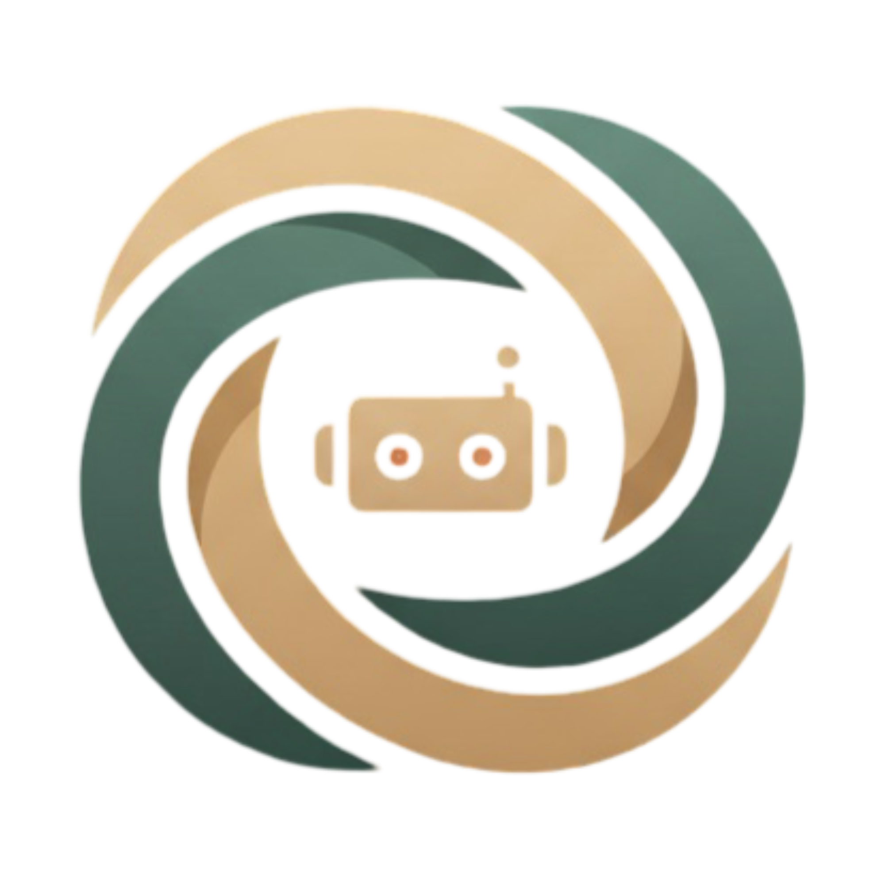
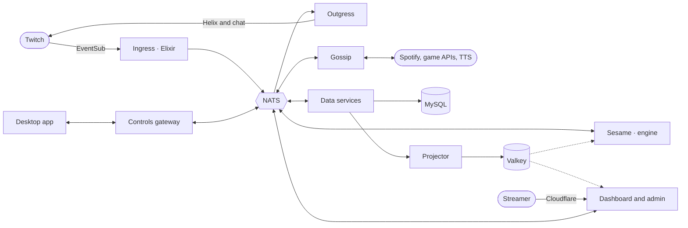

<!-- Copyright (c) 2026 Adam Ousmer. All rights reserved.
     Proprietary. No license granted. See LICENSE.md. -->
[forks-shield]: https://img.shields.io/github/forks/AdamOusmer/ItsBagelBot.svg?style=for-the-badge

[forks-url]: https://github.com/AdamOusmer/ItsBagelBot/network/members

[stars-shield]: https://img.shields.io/github/stars/AdamOusmer/ItsBagelBot.svg?style=for-the-badge

[stars-url]: https://github.com/AdamOusmer/ItsBagelBot/stargazers

[issues-shield]: https://img.shields.io/github/issues/AdamOusmer/ItsBagelBot.svg?style=for-the-badge

[issues-url]: https://github.com/AdamOusmer/ItsBagelBot/issues

[license-shield]: https://img.shields.io/badge/License-Proprietary-red.svg?style=for-the-badge

[license-url]: LICENSE.md

[![Forks][forks-shield]][forks-url]
[![Stargazers][stars-shield]][stars-url]
[![Issues][issues-shield]][issues-url]
[![License][license-shield]][license-url]

  

<h3 align="center">ItsBagelBot</h3>

  

    Zero downtime, Infinite bagels.
     
    Because a monolith wasn't complicated enough.
     
     
    <a href="https://docs.itsbagelbot.com"><strong>Explore the docs »</strong></a>
     
    <a href="https://itsbagelbot.com">Website</a>
    &middot;
    <a href="https://github.com/AdamOusmer/ItsBagelBot/issues/new?labels=bug">Report Bug</a>
    &middot;
    <a href="https://github.com/AdamOusmer/ItsBagelBot/issues/new?labels=feature">Request Feature</a>
     
     
    

 

***

  
Table of Contents

  <ol>
    <li><a href="#about-the-project">About The Project</a>
      <ul>
        <li><a href="#features">Features</a></li>
      </ul>
    </li>
    <li><a href="#architecture-overview">Architecture Overview</a>
      <ul>
        <li><a href="#services">Services</a></li>
        <li><a href="#repository-layout">Repository Layout</a></li>
        <li><a href="#tech-stack">Tech Stack</a></li>
        <li><a href="#security">Security</a></li>
      </ul>
    </li>
    <li><a href="#getting-started">Getting Started</a></li>
    <li><a href="#contributing">Contributing</a></li>
    <li><a href="#license">License</a></li>
    <li><a href="#contact">Contact</a></li>
    <li><a href="#acknowledgements">Acknowledgements</a></li>
  </ol>

***

## About The Project

ItsBagelBot is a free hosted Twitch chat bot. Streamers connect their channel and set everything up in the browser at [itsbagelbot.com](https://itsbagelbot.com).

I built it because I was running too many bots at once to get the features I wanted. I wanted one bot that handles everything in one place, and I wanted to build it the way I would build a production system.

Some might say it's over-engineered for a Twitch bot. It is. I also use it to learn, try modern engineering practices on a project I care about, and show what I can build.

The bot and its data run on servers in Canada powered by hydro-electricity. The website and dashboards are served through Cloudflare.

### Features

- **Custom commands** with variables, aliases, cooldowns and per-command permission levels.
- **Spotify song requests** with a viewer queue and a public song page.
- **Timers** that post on a cadence while the stream is live.
- **Loyalty points**, watchtime, counters and leaderboards.
- **Giveaways and raffles**, including Premium time as a prize.
- **Moderation** with AutoMod rules and banned-word filters on incoming chat, plus a safety check on every reply the bot sends.
- **Automations** built from steps and conditions in the dashboard.
- **Overlays and voice alerts** for OBS, including text-to-speech.
- **Integrations** such as game stats, quotes and Govee lights on channel point redemptions.
- **English and French** across the site, dashboard and chat replies.

Finished features are free. Modules still in beta open to Premium channels first.

***

## Architecture Overview

ItsBagelBot is a set of small services that talk over NATS. Each one can be updated on its own, which is how the bot stays up during releases.

Ingress receives events. Engines decide what to do. Outgress performs platform effects. Data services own their schemas and expose contracts over NATS; other services never reach into their tables. Projector builds shared read models from owner events. Gossip owns external API calls and their upstream budgets.

The [architecture guide](web/docs/src/content/docs/architecture/index.md) explains the paths in detail, and the [decision log](web/docs/src/content/docs/adr/index.md) records why the main boundaries exist.

### Services

| Service | Role |
| --- | --- |
| **Twitch Ingress** (Elixir/OTP) | Manages EventSub through Twitch conduits, then normalizes, filters and publishes events to the bus. |
| **Sesame** (Go) | The Twitch engine: chat, commands, modules, timers, variables and moderation. |
| **Twitch Outgress** (Go) | Sends chat messages and runs Twitch API actions with per-broadcaster rate limits and the bot token lifecycle. |
| **Data services** (Go) | Users, Admin, Commands, Modules, Loyalty, Transactions, Notifications and Overlays. Each owns one MySQL schema and answers RPC for its data. |
| **Projector** (Go) | Folds data-owner events into shared Valkey read models and serves cache-oriented reads. |
| **Gossip** (Go) | Gateway for external APIs, with caching, upstream budgets and credential resolution. A WARP sidecar serves its untrusted HTTP route. |
| **Controls gateway** (Elixir) | WebSocket endpoint for the desktop app. Verifies device tokens and relays events and commands over NATS. |
| **Desktop app** (Go, Wails, Svelte) | Early desktop client. It currently ships the sign-in screen. |
| **Web consoles** (SvelteKit, Astro, Bun) | The dashboard and admin console use SvelteKit. The marketing site and docs use Astro. |
| **Release** (Go, GitHub Actions) | Tags, builds and pins a release, then moves the `deploy` branch that Flux syncs to the cluster. |

[CONTEXT-MAP.md](CONTEXT-MAP.md) lists every owner with its local guide.

### Repository Layout

| Path | Contents |
| --- | --- |
| `app/` | Service implementations. |
| `internal/` | Shared product contracts and engine support. |
| `pkg/` | Reusable runtime packages: bus, database, Valkey, boot, crypto and rate limiting. Services use these instead of opening their own backend clients. |
| `web/` | Bun workspace for the SvelteKit consoles, Astro sites and `@bagel/kit`. |
| `ui/` | Shared components and design tokens (`@bagel/ui`). |
| `locales/` | Translated catalogs for chat, consoles, website and docs. |
| `deploy/` | Kubernetes manifests and cluster configuration. Not needed to understand the command engine. |

### Tech Stack

#### Languages

#### Technologies &amp; Tools

#### Security &amp; Encryption

#### DevOps

#### Infrastructure

#### Monitoring &amp; Logging

### Security

I take security seriously. Here is what is in place:

- Configuration data and third-party credentials are encrypted at rest with Tink, and traffic between services runs over TLS.
- Every service connects to NATS over mutual TLS and authenticates with its own JWT account, limited to the subjects it needs.
- Cluster nodes talk over Tailscale behind a strict firewall that opens only the ports the bot needs. Cilium network policies limit which pods can reach each other.
- Secrets come from Doppler at runtime and never live in the repository. Gitleaks scans every change.
- Cloudflare handles DNS and DDoS protection in front of the public sites.

***

## Getting Started

Streamers do not need this repository. Add the bot from [itsbagelbot.com](https://itsbagelbot.com) and follow [the setup guides](https://itsbagelbot.com/guides/).

For approved contributors, the [developer setup guide](web/docs/src/content/docs/guides/getting-started.md) lists the toolchains and the focused checks for each area, and [testing](web/docs/src/content/docs/guides/testing.md) covers how to validate a change. Start with [CONTEXT-MAP.md](CONTEXT-MAP.md) to find the code that owns a behavior, and [CONTEXT.md](CONTEXT.md) for the terms used across the project.

***

## Contributing

If you have suggestions for how ItsBagelBot could be improved, or want to report a bug, please open an issue! I'd love to hear your ideas and help you fix any problems.

Translation-only pull requests are welcome without prior contact. See [the translation guide](TRANSLATIONS.md) for file locations, browser-based editing, and validation.

For contributing code, please contact me directly at [contact@adam-ousmer.dev](mailto:contact@adam-ousmer.dev) before making any changes or submitting a pull request.

***

## License

Proprietary. No license is granted to use, copy, modify or run this software. See [LICENSE.md](LICENSE.md) for the full terms.

***

## Contact

Adam Ousmer - [GitHub](https://github.com/AdamOusmer) - [Email](mailto:contact@adam-ousmer.dev)

Product questions: [contact@itsbagelbot.com](mailto:contact@itsbagelbot.com)

***

## Acknowledgements

README template inspired by [othneildrew/Best-README-Template](https://github.com/othneildrew/Best-README-Template)
