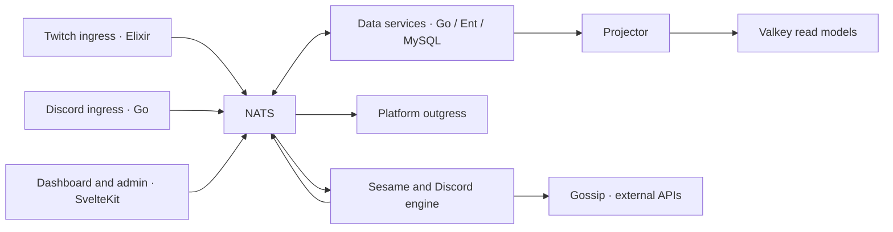

<!-- Copyright (c) 2026 Adam Ousmer. All rights reserved.
     Proprietary. No license granted. See LICENSE.md. -->
# ItsBagelBot

Zero downtime, infinite bagels. Because a monolith wasn't complicated enough.

I built ItsBagelBot because I was running too many bots to get the features I wanted. It handles Twitch commands, modules, timers, moderation, song requests and loyalty, with Discord integration and a web console to configure it.

Some might say it's over-engineered for a Twitch bot. It is. I also use it to learn, experiment and build something I want to run.

## Start with the code

- [Engineering docs](https://docs.itsbagelbot.com): architecture, services, state, contracts and decisions.
- [Context map](CONTEXT-MAP.md): find the owner of a behavior and its local code guide.
- [Product glossary](CONTEXT.md): the terms used across the project.
- [Developer setup](web/docs/src/content/docs/guides/getting-started.md): toolchains and focused checks.
- [Testing](web/docs/src/content/docs/guides/testing.md): validate the area you changed.

Streamer setup guides live on [the product site](https://itsbagelbot.com/guides/).

## How it fits together

Ingress receives events. Engines decide what to do. Outgress performs platform effects. Data services own their schemas and expose contracts over NATS; other services do not reach into their tables. Projector builds shared read models from owner events and snapshots. Gossip owns external API calls and their upstream budgets.

`app/` contains service implementations. `internal/` contains shared product contracts and engine support. `pkg/` contains reusable runtime packages, including bus, database, Valkey, boot and rate limiting. Service code uses these packages instead of opening its own backend clients.

`web/` is the Bun workspace for the SvelteKit consoles, Astro sites and `@bagel/kit`. `ui/` contains shared components and design tokens. `locales/` contains translated catalogs. `deploy/` contains deployment configuration and operational tooling; it is not needed to understand the command engine.

The [architecture guide](web/docs/src/content/docs/architecture/index.md) explains the paths in detail. The [decision log](web/docs/src/content/docs/adr/index.md) records why the consequential boundaries exist.

## Contributing

Issues and suggestions are welcome. Translation-only pull requests do not need prior contact; see [TRANSLATIONS.md](TRANSLATIONS.md).

For code contributions, contact [contact@adam-ousmer.dev](mailto:contact@adam-ousmer.dev) before submitting changes.

## License

Proprietary. See [LICENSE.md](LICENSE.md).
