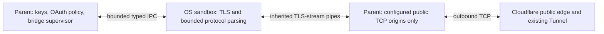

# Isolated desktop networking

This package supervises the desktop's separate Go network helper and its fixed
pipe capabilities. The parent owns credentials and application policy; the
helper owns TLS and parsing of server HTTP, OAuth JSON, WebSocket frames and
protobuf. Neither OAuth nor bridge transport constructs an unrestricted client
when this required port is missing.



The worker receives the access/refresh credentials needed for its service
requests and already-created DPoP proofs. It does not receive the installation
private key, credential-store access, parent environment or general host APIs.
OAuth responses return as bounded typed fields, and event messages are decoded
and validated before typed IPC delivery. The parent still decodes that private
IPC format and remains part of the trusted computing base.

## Ownership

| Owner | Responsibility |
| --- | --- |
| `internal/oauth` in the parent | PKCE/state, OS credential item, installation key, proof creation, refresh rotation/persistence and account lifecycle |
| `internal/bridge/session` in the parent | Binding, primary/candidate identities, deadlines, jittered retries, cursor/replay ordering and handoff |
| `supervisor.go` | Required helper launch, cancellable startup and a separate process-restart budget |
| `bridge_port.go` | Account-owned scope of at most two streams and four controls; closing it preserves global OAuth networking |
| `client.go` / `peer.go` | Fixed typed requests/responses, outstanding leases, cancellation and fail-closed protocol handling |
| `broker.go` in the parent | DNS/address validation and raw TCP creation for the configured origin indexes |
| `worker.go` / `lanes.go` in the helper | Bound operation/stream ownership, TLS over inherited pipes, safe decoding, ACK backpressure and deterministic cleanup |
| `pkg/sandbox` | Platform-specific process isolation, independent of application protocol and credentials |

The shared `pkg/websocket`, `pkg/protobuf`, `pkg/codec`, `pkg/dpop` and
`pkg/credential` wrappers retain dependency ownership. No vendor WebSocket or
protobuf implementation is imported directly into handwritten app code.

## Startup and capabilities

The parent launches only the required helper. The helper verifies actual kernel
restrictions before sending its isolation handshake. Invalid/missing isolation,
malformed handshakes or unavailable platform prerequisites stop remote
authorization; there is no in-process HTTP/WebSocket fallback. Bootstrap contains
the configured public auth/event origins and public trust material, not private
keys or credential-store contents.

The worker cannot create its own network sockets. It can request one of four
raw TCP slots for an origin index already selected by the parent. The parent
resolves that origin, rejects private, loopback, link-local and CGNAT addresses,
and dials the same validated numeric address. The worker cannot replace the
hostname, select another port or request a general proxy. Raw lanes carry TLS
records, including encrypted application data; TLS runs in the helper. Epochs fence stale data after slot reuse.

The typed control pipe supports only bootstrap, token/revoke requests, event
upgrade/control requests, stream ACK/close and fixed raw-lane operations. It has
no exec, arbitrary file path, filesystem read/write or application-update command.
The helper never gets a listening socket. The new-device browser callback is a
separate, temporary parent-owned Fiber listener on `127.0.0.1`; renewals use
outbound HTTPS without reopening it.

## Received-packet boundary

Remote bytes follow this path before any application effect:

1. The sandboxed transport accepts bounded binary frames and safely decodes them
   into the fixed protobuf struct, without input-buffer aliases.
2. Protocol validation rejects unsupported versions/kinds, unknown fields at
   every nested level, incompatible payloads, extraneous known fields and invalid
   or oversized values. Strings remain untrusted data, never executable code.
3. The private pipe carries only that typed message. Before matching responses or
   dispatching, the parent checks the envelope's exact operation shape, direction,
   required fields, fixed bounds and nested message. Responses must match the
   outstanding operation type as well as its generation ID.
4. The supervisor validates again, applies session/sequence/account policy and
   hands a borrowed typed event to the native consumer. Server values cannot
   select a Go function, shell command, CLI configuration, file path, executable,
   plugin, script or host-information query.

OAuth JSON is separately decoded with `pkg/codec.UnmarshalStrict` inside the
worker. Unknown properties and trailing documents fail before any typed response
crosses the pipe; classified errors never forward arbitrary response bodies.

There is no packet/API capability for interface enumeration, public-IP discovery,
environment retrieval or reporting machine metadata. The broker necessarily
resolves the configured server hostname; this does not discover the user's IP.
Cloudflare can see the source IP of an outbound connection, and may forward that
address to the origin. Neither this protocol nor an OS process sandbox provides
network anonymity. Native interface-enumeration denial on macOS/Windows is not
claimed by these tests.

AST import/selector guards pin the few parent host capabilities to exact startup
and broker functions. They reject command execution, filesystem/CLI mutation,
host/IP discovery, arbitrary networking and dynamic-code dependencies in
handwritten packet-processing packages. These guards supplement runtime checks;
they do not constitute a general proof about arbitrary future code. No production
event consumer is installed yet. A future renderer must preserve data-only event
handling and escaped text, with separately reviewed asset and local-I/O ports.

## Fixed bounds and recovery

| Resource | Bound |
| --- | --- |
| OS helper replacement | Three starts per 30-second window; no unrestricted fallback |
| Raw TCP capabilities | Four slots, restricted to the configured public origins |
| Event sockets | Two reserved/active/closing streams, including pending upgrades |
| Concurrent helper operations | Four, cancellable and deadline-bound |
| Account control scope | Four operations; scope close cancels them without closing global OAuth |
| Outstanding pipe calls | Sixteen; cancellation notifications also have a fixed queue |
| Event message | 64 KiB |
| Supervisor pending event ring | Sixteen owned typed events |
| Private control frame | 128 KiB, checked before reading/decoding its body |
| Incoming control-pipe work | 4096 frames and 16 MiB per second; excess closes the peer |
| Each raw TCP lane | 4096 chunks and 16 MiB per second; excess closes the capability |
| Partial control packet | One second from its first byte to completion |
| OAuth HTTP reply | 16 KiB; parsed only in the helper |
| Private typed metadata | Token 8 KiB, proof 4 KiB, nonce 512 bytes, OAuth form 4 KiB; bounded typed token reply |

These are local security/resource bounds, not Cloudflare billing quotas. Payload
processing remains linear in bounded bytes. Fixed slots and queue operations do
not scan an unbounded population of sockets or events.

A stream reserves its slot before asynchronous upgrade. Each stream has its own
context for reads and ACK waits. A five-second upgrade timer is stopped after
success without cancelling the live stream. Closing a pending upgrade cancels
it; a late successful connection is closed before escaping its owner. A closing
socket retains its slot until its existing owner finishes cleanup, preventing
unbounded close goroutines. EOF/shutdown cancels and joins request/receive owners.

One typed frame can be outstanding per stream until the parent requests the next
read. A worker flooding past that ACK window closes the peer. Generation IDs
prevent late responses from completing another call, and cancelled calls do not
publish new credentials. Root framing and CPU-work budgets are applied before
payload decoding. IPC is deliberately small, but its decoder is trusted; the
sandbox does not make every parent-side operation immune to vulnerabilities.

OAuth attempts use three-second request contexts within a ten-second exchange
budget. Helper operations and upgrades have five-second bounds; bootstrap has a
ten-second maximum while respecting the caller's shorter attempt context. These
attempt deadlines do not become live-socket expiry timers. The app's stream
supervisor separately applies five tries within 30 seconds, exponential backoff
with jitter, server migration windows and its 45-second activity watchdog.

Ordinary server handoffs preserve the helper process. A fatal helper/IPC failure
closes its capabilities and becomes a bounded reconnect, never an unrestricted
fallback. Lossless recovery still requires the server's cursor retention and
replay contract. A server or compromised helper can disrupt allowed traffic;
the boundary constrains its host access rather than promising uninterrupted
physical connections or immunity to OS vulnerabilities.

## Platform evidence and release gates

On macOS arm64, actual ad-hoc signed helper tests passed App Sandbox and the
fixed deny-only policy, including direct Keychain access, `/usr/bin/security`,
home-file, parent-memory, process-exec and direct-network denial. The CLI check
matters: direct Keychain denial alone did not initially block that confused
deputy. See [the exact policy and evidence](../../../../pkg/sandbox/DARWIN.md).
The parent owns [protected credentials](../../../../pkg/credential/README.md);
hardware non-exportability is not claimed.

The macOS helper is a separately signed nested app with its own identifier and
minimal entitlements, without parent sandbox inheritance. The temporary SBPL
entitlement is an implementation-dependent release requirement: validate it
with the real Developer ID identity, notarization and each supported OS. Failed
policy verification or probes disable the feature. Development ad-hoc results
are not distribution or App Store approval.

Windows uses an AppContainer without broad file/network capabilities and a job
for process/resource ownership. Linux requires the static helper plus bubblewrap,
namespaces, no-new-privileges and seccomp. Windows/Linux code was cross-compiled,
but their kernel restrictions were not runtime-verified here. Intel Mac runtime
behavior likewise remains a separate check. Package names and locations are
resolved by `HelperPath`; build tasks include the helper beside the app or as a
macOS nested app. Do not substitute an unsigned or unrestricted helper.

## Verification

From `app/desktop`:

```sh
go test -race ./internal/network ./internal/oauth ./internal/bridge/...
go vet ./internal/network ./internal/oauth ./internal/bridge/...

# After building/signing the production helper bundle on macOS:
BAGEL_TEST_SANDBOX_WORKER=/absolute/path/to/BagelNetworkWorker.app/Contents/MacOS/BagelNetworkWorker \
  go test -race ./internal/network -run '^TestSandbox' -count=1 -v
```

Normal tests use controlled local TLS fixtures and exercise queue bounds,
malformed/truncated/oversized frames, limits before decode, duplicate/stale RPC
responses, cancellation, one-shot stream ownership, blocked upgrades, ACK waits,
two-stream isolation and borrowed scope cleanup. Real-helper tests additionally
exercise the production kernel sandbox with TLS/OAuth and typed stream delivery.
Controlled test roots do not by themselves prove public system-root trust or
Cloudflare compatibility; the exact live modes/results belong in
[the Tunnel report](../bridge/TUNNEL_RESULTS.md).

The warmed bridge supervisor dispatch and the borrowed receive adapter have
zero-allocation regression checks. They exclude TLS, wire/IPC decoding, safe
string copies and process startup. No zero-allocation or measured throughput
claim is made for the full isolated network path.
