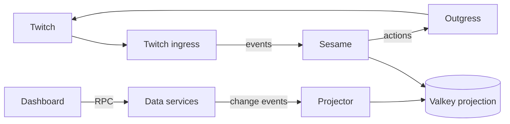

---
# Copyright (c) 2026 Adam Ousmer. All rights reserved.
# Proprietary. No license granted. See LICENSE.md.
title: System overview
description: "The boundaries and main request path of ItsBagelBot."
docType: explanation
---

## Scope and components

ItsBagelBot receives platform events, evaluates bot behaviour, and sends actions back to the platform. Broadcasters configure that behaviour through the dashboard. The services communicate over NATS; the data services own their schemas and expose operations rather than sharing database access.

The Twitch ingress is Elixir (`app/twitch/ingress`); Sesame and outgress are Go (`app/twitch/sesame`, `app/twitch/outgress`). The dashboard and admin apps live under `web/`.

This diagram is a starting point, not a complete dependency graph. See [system state](/reference/system-overview/) for the service map, [data and state](/data-and-state/) for ownership and consistency, and `CONTEXT-MAP.md` for the repository's context boundaries. Deployment configuration is under `deploy/`.

## Follow an event through the code

1. [Ingress](https://github.com/AdamOusmer/ItsBagelBot/tree/main/app/twitch/ingress/) receives Twitch events and publishes normalized messages. Subject and stream choices distinguish traffic lanes; see [stream definitions](https://github.com/AdamOusmer/ItsBagelBot/blob/main/pkg/bus/streams.go).
2. [Sesame](https://github.com/AdamOusmer/ItsBagelBot/tree/main/app/twitch/sesame/) loads the channel context and applies module and command gates. A missing read-model entry can require an owner RPC; the [projection client](https://github.com/AdamOusmer/ItsBagelBot/blob/main/internal/projection/client.go) implements those reads.
3. Sesame publishes an action for [outgress](https://github.com/AdamOusmer/ItsBagelBot/tree/main/app/twitch/outgress/), which carries out the platform request. An accepted message and a successful Twitch API action are separate outcomes.

The request path has deadlines and bounded retention. A consumer restart can resume retained work, but cannot recover messages already expired from a stream. Callers must handle unavailable dependencies and timeouts; see [RPC contracts](/reference/rpc-contracts/) and [settings projection](/data-and-state/projection/).

## Change a cross-service feature

Start with the owning service and its domain contract under [internal/domain](https://github.com/AdamOusmer/ItsBagelBot/tree/main/internal/domain/). Trace the publisher or RPC client, handler, storage and downstream consumers. Change both sides and their tests together; deployment permissions for subjects are in [accounts.yaml](https://github.com/AdamOusmer/ItsBagelBot/blob/main/deploy/messaging/accounts.yaml). Keep backend access in the [shared packages](/reference/shared-packages/) and review whether the new operation needs a durable result, a retry-safe effect or a disposable projection.
