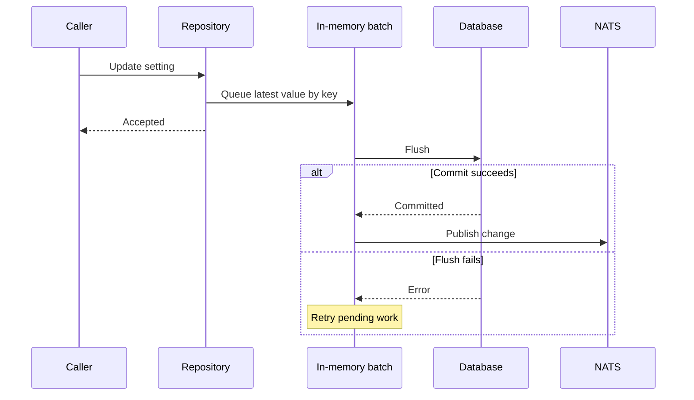

---
# Copyright (c) 2026 Adam Ousmer. All rights reserved.
# Proprietary. No license granted. See LICENSE.md.
title: Caching and write-behind
description: "Read caches, batching and durability boundaries."
docType: explanation
---

## Scope and read path

`pkg/cache` provides bounded in-process caches and load coalescing. Data-service repositories use them to avoid repeated database reads; invalidation messages let other instances discard old entries. Exact TTLs and stale-on-error behaviour depend on the caller, so inspect the repository rather than assuming every cache has the same policy.

## Write path and durability

`pkg/batch` coalesces pending writes by key and calls a service-provided flush function. Commands, modules and some user preferences use write-behind. The pending values live in process memory: an accepted update can be lost if the process stops before a successful flush. A failed flush is retried; it does not turn the earlier response into a durable commit. Do not use this mechanism for money or tokens.

For implementation and failure details, start with `pkg/batch/batcher.go`, `pkg/cache`, and the relevant `app/db/<service>/repository/`. The projection is another derived read model, described [separately](/data-and-state/projection/).

## What happens when writes overlap

Suppose updates A and B use the same batch key. `Add` replaces the pending value, so a flush that has not yet taken the map sees B. If A is already being flushed when B arrives, B enters the new pending map. If A fails, the batcher restores A only if no newer value for that key is pending; B is not overwritten. See [`Add` and `flushPending`](https://github.com/AdamOusmer/ItsBagelBot/blob/main/pkg/batch/batcher.go) and their tests.

A normal close attempts to drain pending work within the supplied context. A crash cannot run that drain. The flush callback decides its own database transaction and event publication, so check the particular repository rather than assuming every batch has identical effects.

## Read failures and invalidation

The [projection client](https://github.com/AdamOusmer/ItsBagelBot/blob/main/internal/projection/client.go) configures local caches with stale-on-error and listens for invalidations. Its users, modules and commands have separate caches. On a cold read it can request an owner snapshot; the modules path also uses a short outage backoff. The [RPC tests](https://github.com/AdamOusmer/ItsBagelBot/blob/main/internal/projection/client_rpc_test.go) cover retry after errors and clearing that backoff on invalidation. These are client-specific policies, not guarantees of every `pkg/cache` user.

When modifying a cached write, test the local value, invalidation on another instance, a failed reload, and a newer write arriving during a failed flush. For durable state, choose a direct path and test what happens when the caller retries after an ambiguous timeout.
