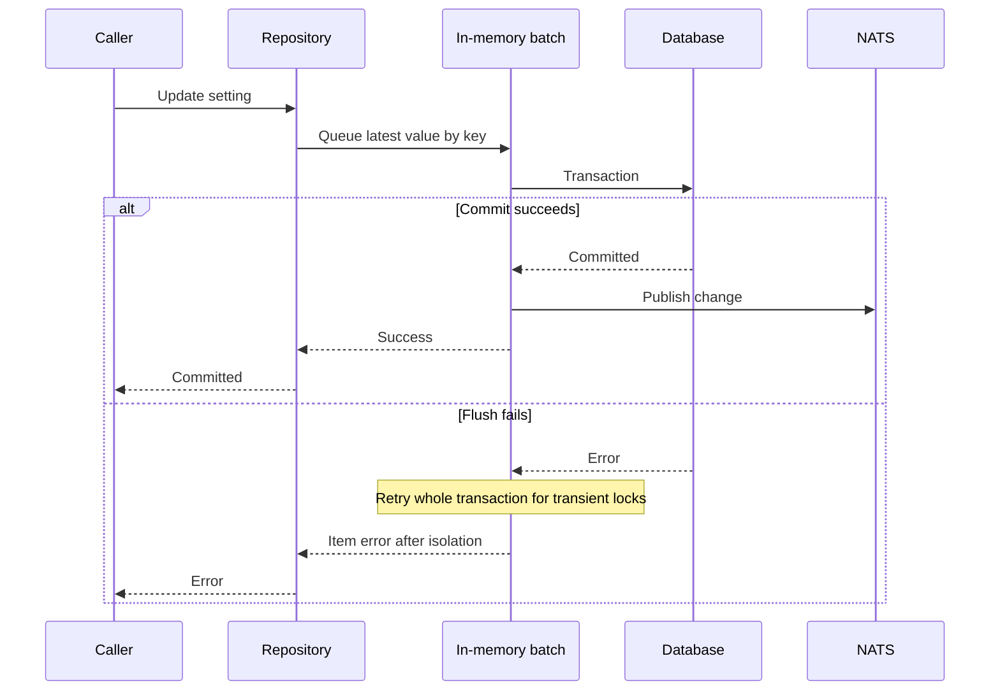

---
# Copyright (c) 2026 Adam Ousmer. All rights reserved.
# Proprietary. No license granted. See LICENSE.md.
title: Caching and committed writes
description: "Read caches, batching and durability boundaries."
docType: explanation
---

## Scope and read path

`pkg/cache` provides bounded in-process caches and load coalescing. Data-service repositories use them to avoid repeated database reads; invalidation messages let other instances discard old entries. Exact TTLs and stale-on-error behaviour depend on the caller, so inspect the repository rather than assuming every cache has the same policy.

## Write path and durability

`pkg/batch/group.go` groups command edits and user preferences before calling a service-provided transaction. Callers wait for the MySQL commit before receiving success. Modules use synchronous `SetNow` and patch operations. Pending work lives in memory, so a crash before commit requires the caller to retry. Counter events retain stable receipt identities to make retries idempotent. Financial and credential writes keep their dedicated synchronous paths.

For implementation and failure details, start with `pkg/batch/group.go`, `pkg/cache`, and the relevant `app/db/<service>/repository/`. The projection is another derived read model, described [separately](/data-and-state/projection/).

## What happens when writes overlap

Suppose updates A and B use the same group key. Within one batch, the last admitted value wins and earlier callers share its committed outcome. If B fails with an attributable item error, isolation returns B's error to its caller and attempts A instead. Healthy items can still commit. Row and estimated byte budgets bound each statement; oversized items are rejected before admission. See [`Group`](https://github.com/AdamOusmer/ItsBagelBot/blob/main/pkg/batch/group.go) and its tests.

Grouped command upserts and preferences allow at most 250 ms of queue wait, then a one-second transaction budget, then a separate 250 ms publication budget. These total 1.5 seconds. A plain command upsert also allows 250 ms to acquire the broadcaster lock before admission, for 1.75 seconds overall. These bounds stay below the two-second command and three-second user RPC deadlines. Rename and delete use the caller context for their exclusive lock, SQL and publication; a rename of a missing row then takes the grouped upsert path, so the plain-upsert bound does not apply to the whole rename. Caller cancellation after admission does not detach the reply from the commit result. Grouped post-commit publication gets a fresh context; its failure does not undo committed data.

A normal close attempts to drain pending work within the supplied context. A crash cannot run that drain. The flush callback decides its own database transaction and event publication, so check the particular repository rather than assuming every batch has identical effects.

## Read failures and invalidation

The [projection client](https://github.com/AdamOusmer/ItsBagelBot/blob/main/internal/projection/client.go) configures local caches with stale-on-error and listens for invalidations. Its users, modules and commands have separate caches. On a cold read it can request an owner snapshot; the modules path also uses a short outage backoff. The [RPC tests](https://github.com/AdamOusmer/ItsBagelBot/blob/main/internal/projection/client_rpc_test.go) cover retry after errors and clearing that backoff on invalidation. These are client-specific policies, not guarantees of every `pkg/cache` user.

When modifying a cached write, test the committed local value, invalidation on another instance, a failed reload, poison-item isolation and overlapping edits. Test retries after an ambiguous transport timeout using the operation's idempotency contract.
