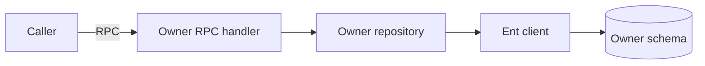

---
# Copyright (c) 2026 Adam Ousmer. All rights reserved.
# Proprietary. No license granted. See LICENSE.md.
title: Database ownership
description: "Where schemas, migrations and database access live."
docType: explanation
---

## Scope and ownership

The data services under `app/db/` own separate MySQL schemas. Their Ent schema definitions live in `app/db/<service>/ent/schema/`, alongside generated Ent code. Repositories and RPC handlers live in the same service. Start there when changing a field: check its schema, repository, RPC DTO, events and callers together.

Cross-service identifiers link records by value. They do not grant permission to query another service's schema. Use the owner's RPC or its published event instead. Shared connection and migration configuration lives in `pkg/db`; service startup wires it through the shared boot packages.

## Request flow

## Durability and failure modes

Not every write has the same durability contract. Some settings use an in-memory batch before the database commit; financial and credential operations need their own direct paths. Read the relevant repository before assuming that a successful response means a commit has completed. See [caching and write-behind](/data-and-state/caching/).

Migration behaviour and credentials are configured at startup; inspect `pkg/db/provider.go` and the service's configuration before running against an existing database. Generated code is not the source of the schema definition.
