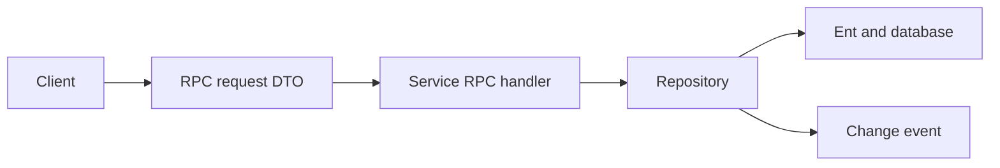

---
# Copyright (c) 2026 Adam Ousmer. All rights reserved.
# Proprietary. No license granted. See LICENSE.md.
title: Data service code
description: "How a request crosses the data service layers."
docType: explanation
---

## Scope and components

A typical data service separates its wire contract, handler and persistence code. This is a navigation aid, not a claim that every operation follows exactly the same path.

- `internal/domain/rpc/` defines shared request and reply types; `internal/domain/event/` defines event payloads.
- `app/db/<service>/rpc/` handles service operations. `app/db/<service>/repository/` implements persistence and any caching or batching for that service.
- `app/db/<service>/ent/schema/` defines Ent entities. Generated Ent code sits beside it.
- `pkg/bus`, `pkg/db`, `pkg/cache` and `pkg/batch` provide shared mechanisms. Service code should use shared packages rather than accessing a backend they own directly.

## Invariants and failures

When changing a contract, trace the caller, handler, repository and consumers. A transport success can still contain an application refusal; inspect the reply's `error` and, where supplied, `code` (`internal/domain/rpc/code.go`).

## Walk a user snapshot

The [projection request DTO](https://github.com/AdamOusmer/ItsBagelBot/blob/main/internal/domain/rpc/projection/projection.go) carries `user_id` as a string. The [users RPC handler](https://github.com/AdamOusmer/ItsBagelBot/blob/main/app/db/users/rpc/projection.go) validates it, calls the repository, maps an absent account to a `not_found` refusal and builds a snapshot. The [hydrator](https://github.com/AdamOusmer/ItsBagelBot/blob/main/app/projector/hydration/hydrator.go) consumes the reply and writes derived state. Neither the caller nor the projector queries the users schema directly.

This separation is useful when extending a field: update the owner schema and repository, then the DTO and handler, projection storage and readers. Add tests at the boundary for serialization and refusals, and at the consumer for missing or stale state. Generated Ent files follow the schema; see [testing](/guides/testing/) and the Go workflow for generation and checks.
