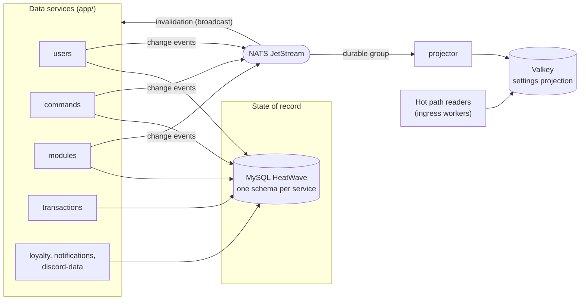

---
# Copyright (c) 2026 Adam Ousmer. All rights reserved.
# Proprietary. No license granted. See LICENSE.md.
title: Data plane overview
description: "The data services, what they own, and how state moves between MySQL, the caches, NATS, and the Valkey projection."
sidebar:
  order: 1
---

The data plane is seven bounded-context services plus a projector, all under `app/`. Each service owns its own MySQL
schema on HeatWave ([ADR 0005](/adr/0005-adoption-of-mysql-heatwave/)). The users, commands and modules services
announce every committed change as an event on NATS ([ADR 0003](/adr/0003-adoption-of-nats-as-communication-bridge/)),
and the projector folds those events into the Valkey settings projection that the hot path reads.

This page is the component view. The rest of the section goes deeper:

- [Database design](/data-and-state/database/): the conceptual model, the physical schemas, and the integrity rules.
- [Caching and write-behind](/data-and-state/caching/): the read and write paths, with their UML sequence and state
  diagrams.
- [Class design](/data-and-state/design/): the UML class diagrams and the design patterns in play.
- [Settings projection](/data-and-state/projection/): the Valkey layout and the rebuild protocol.

## Component diagram

## Ownership

| Service | Schema | Owns | Write path |
|---------|--------|------|------------|
| `app/db/users` | `bagel_users` | Accounts (Twitch ID, username, email, status, ban, locale, subscription state, staff and delegation records, Premium grants) and OAuth tokens as Tink AEAD ciphertext | Status, ban and tokens direct; preferences (active flag, locale, cursor, onboarding, creator code) write-behind |
| `app/db/commands` | `bagel_commands` | Custom chat commands, aliases, use totals, custom-fetch definitions and keys | Write-behind (deletes direct) |
| `app/db/modules` | `bagel_modules` | Module toggles and JSON configurations, quotes, integration credentials, feed counters | Write-behind |
| `app/db/loyalty` | `bagel_loyalty` | Viewer balances, watchtime, channel counters and entries | Batched, idempotent by receipt |
| `app/db/transactions` | `bagel_transactions` | Tebex agreements and webhook events, billing operations, giveaways, draws, awards and award emails | Direct, idempotent on retry |
| `app/db/notifications` | `bagel_notifications` | Account-facing notification records | Direct |
| `app/db/discord` | `bagel_discord` | Guild bindings and configuration, tickets, transcripts, member XP | Direct |
| `app/projector` | none | The Valkey projection (disposable, rebuildable) | Event-driven overwrites |

Cross-service references are a plain indexed Twitch user ID column. There are no foreign keys across schemas, by
construction.

## Event contracts

The subjects and payload DTOs live in `internal/domain/event/data` and are a public contract: renaming a subject or
narrowing a payload is a breaking change. The change events carry the full new state (event-carried state transfer),
so consumers never read another service's schema and redelivery is harmless.

| Subject | Payload | Published when |
|---------|---------|----------------|
| `data.users.changed` | user ID, username, active, status, banned, locale, commands-page-hidden, state revision, account incarnation | Registration, rename, status, ban, locale or preference change |
| `data.users.deleted` | user ID, account incarnation and deletion time | User deletion |
| `data.modules.changed` | user ID, module name, enabled, config JSON, revision | Each module row landed by a flush |
| `data.commands.changed` | user ID, name, aliases, response, active, stream-online-only, permissions, cooldowns, allowed user, uses, bump counter, deleted flag | Each command row landed by a flush, and deletions |
| `data.commands.fetch_changed` | user ID, fetch name, URL, JSON path, key label, active, deleted flag | A custom-fetch definition changes |
| `data.commands.used` | user ID, command name, count | Batched command-use reports |
| `data.loyalty.earned`, `data.loyalty.counters` | viewer earnings and counter bumps | Sesame reports activity |
| `data.twitch.clip.created` | broadcaster ID, clip ID, URL | A clip is created |
| `data.reproject.request` | empty | Projector cold start; owners replay their state as ordinary change events |

All `data.>` subjects are captured by the `BAGEL_DATA` JetStream stream (5 minute retention, file storage, three
replicas, `pkg/bus/streams.go`).

Two subscription shapes, on purpose:

- **Broadcast (no queue group):** cache invalidation. Every instance of a service drops its cached keys when any
  instance writes.
- **Durable queue group:** the projector, and the reproject responders. Exactly one consumer per group handles each
  event, and the group keeps its position across restarts.

Consumers validate every payload and **drop** (log and ack) what fails to decode or validate. Nacking a poison
message would redeliver it forever.

## Configuration

Every service reads its configuration from the environment. Common variables:

| Variable | Default | Used by |
|----------|---------|---------|
| `APP_ENV` | `development` | all (logger profile) |
| `NATS_URL` | `nats://127.0.0.1:4222` | all |
| `DB_ADDR` | `127.0.0.1:3306` | data services |
| `DB_USER`, `DB_PASS` | required | data services |
| `DB_SCHEMA` | `bagel_<service>` | data services |
| `DB_CA_CERT` | required | data services; the pinned HeatWave CA PEM (`pkg/db/provider.go`); startup fails when it is absent or invalid |
| `DB_TLS_MODE` | `VERIFY_CA` | data services; `pkg/db/provider.go` |
| `DB_AUTO_MIGRATE` | `true` | data services; run the ent schema migration at startup |
| `DB_ADMIN_CA_CERT` | falls back to `DB_CA_CERT` | admin console; the HeatWave CA PEM for the privileged schema-admin connection (`web/admin/src/lib/server/secrets.ts`) |
| `TINK_KEYSET_PATH` | required for users; optional for commands and modules (key custody is disabled with a warning when absent) | users, commands, modules |
| `VALKEY_ADDR` | `127.0.0.1:6379` | services that use Valkey (`pkg/svcboot/infra.go`) |
| `VALKEY_PASSWORD` | empty | services that use Valkey |
| `NEW_RELIC_LICENSE_KEY` | empty (monitoring disabled) | all |

Monitoring is a no-op without a license key, so local development needs none of the `NEW_RELIC_*` variables.
