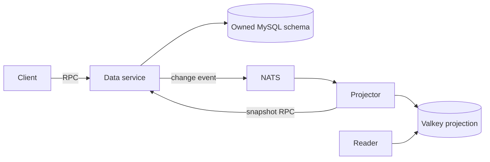

---
# Copyright (c) 2026 Adam Ousmer. All rights reserved.
# Proprietary. No license granted. See LICENSE.md.
title: Data and state
description: "Ownership and movement of application state."
docType: explanation
---

## Scope and flow

Each service under `app/db/` owns its schema and exposes operations over NATS. Other services use those operations or consume events; they do not query another owner's tables. `app/projector` maintains derived state in Valkey for frequent reads.

## Ownership

| Owner | Main state |
| --- | --- |
| `app/db/users` | Accounts, lifecycle, grants and tokens |
| `app/db/commands` | Commands, aliases and custom fetches |
| `app/db/modules` | Module settings and module-owned data |
| `app/db/loyalty` | Balances, watchtime and counters |
| `app/db/transactions` | Billing, giveaways and awards |
| `app/db/notifications` | Notifications |
| `app/db/discord` | Discord configuration and records |

See [database](/data-and-state/database/), [caching and write-behind](/data-and-state/caching/), [code design](/data-and-state/design/) and [projection](/data-and-state/projection/). Event definitions are in `internal/domain/event/data`; stream configuration is in `pkg/bus/streams.go`. A durable consumer can resume only while its messages remain retained; the stream is not an indefinite event log.
