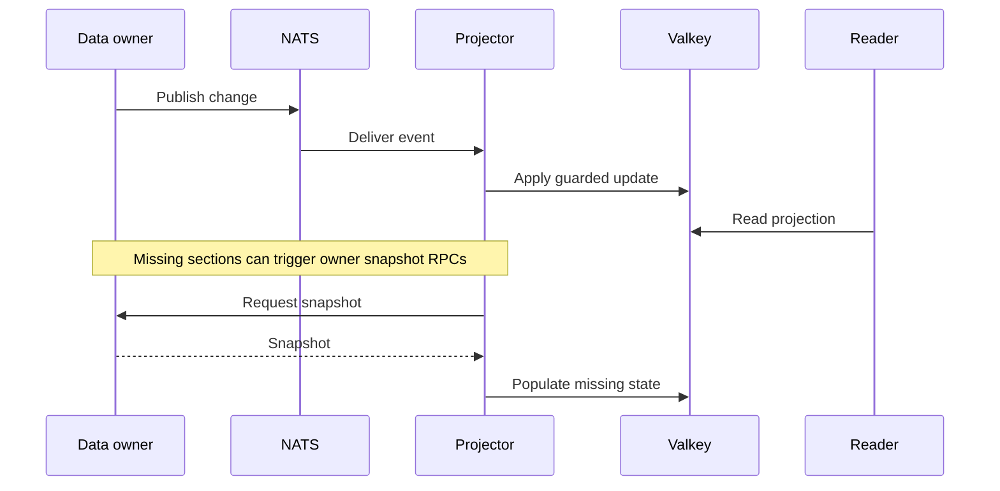

---
# Copyright (c) 2026 Adam Ousmer. All rights reserved.
# Proprietary. No license granted. See LICENSE.md.
title: Settings projection
description: "The derived Valkey read model and its recovery paths."
docType: explanation
---

## Scope and components

`app/projector` maintains a derived read model in Valkey. Its key and field operations live in `internal/projection/`; the data services remain the owners of persisted records. Readers can request snapshots through the projection RPC contracts in `internal/domain/rpc/projection/`.

The `settings:<user_id>` hash includes user state and sections for modules, commands and fetches. Section markers distinguish an empty result from a section that has not been projected. Related admission and revision keys protect lifecycle and versioned updates. Runtime admission reads use the primary; see `internal/projection/runtime.go`.

## Invariants and failure modes

The projector consumes changes and applies revision and account-incarnation guards where implemented. Redelivery is possible; do not assume exactly-once delivery. Hydration in `app/projector/hydration/` fetches user, module and command snapshots over RPC, bounds concurrency and retries, and gates work per user. Query hydration and live refresh have separate TTLs. Inspect the implementation and service configuration for current defaults.

The `data.reproject.request` event asks owners to replay state; the projector does not itself issue that request. A retained event can be redelivered after a failure, but retention is finite. Repair after a longer outage depends on hydration, later changes or an explicitly requested replay. A Valkey failure can make projection reads unavailable; recovery is not a promise that every derived counter can be reconstructed from the settings owners. Follow the individual handler and its storage errors when changing failure handling.

## Cold read and recovery

The [projection client](https://github.com/AdamOusmer/ItsBagelBot/blob/main/internal/projection/client.go) has local caches for users, modules, commands and fetches. On a miss it checks the store and can request the owning service over NATS. The client configures stale-on-error caches; module RPC failures also have a short outage backoff. This is distinct from the projector's asynchronous hydration. Tests in [client_rpc_test.go](https://github.com/AdamOusmer/ItsBagelBot/blob/main/internal/projection/client_rpc_test.go) cover errors, retry and invalidation.

The [hydrator](https://github.com/AdamOusmer/ItsBagelBot/blob/main/app/projector/hydration/hydrator.go) requests snapshots with bounded concurrency, up to three attempts, and per-user gates. A query can seed known module or command data; a live refresh forces a fresh run. A failed request does not make a partially hydrated hash a complete snapshot. Section markers matter: absence means the reader must not confuse “not loaded” with “loaded and empty.”

## Changing a projected field

1. Add or change the owner DTO in [projection contracts](https://github.com/AdamOusmer/ItsBagelBot/blob/main/internal/domain/rpc/projection/projection.go), its handler and its corresponding change-event payload where applicable.
2. Update the store's read/write representation under [internal/projection](https://github.com/AdamOusmer/ItsBagelBot/tree/main/internal/projection/) and the projector handler or hydration path. Preserve the appropriate revision and account-incarnation checks.
3. Update consumers and tests for an empty section, a stale or replayed update, and owner/Valkey failure. Check both a cold read and a change after hydration.

Do not treat the event stream as the database: [DATA](https://github.com/AdamOusmer/ItsBagelBot/blob/main/pkg/bus/streams.go) has bounded retention. Likewise, a healthy hash is derived state and may lag its owner while events or hydration are in flight.
