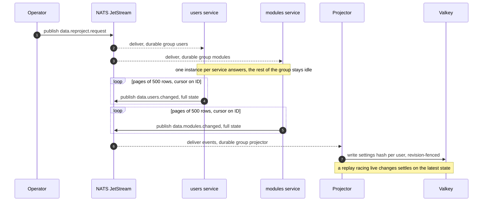

---
# Copyright (c) 2026 Adam Ousmer. All rights reserved.
# Proprietary. No license granted. See LICENSE.md.
title: Settings projection
description: "The Valkey read model: hash layout, the live event flow, and the reproject handshake that rebuilds it from scratch."
sidebar:
  order: 5
---

The hot path of the system is reacting to a chat message, and that read cannot touch MySQL. The projector
(`app/projector`) maintains a denormalized read model in Valkey: everything the hot path needs about a channel,
fetchable in one round trip. The projection is a cache, never the system of record; MySQL can rebuild it at any
time. The key layout lives in `internal/projection`.

## Layout

One hash per user, `settings:<user_id>`, readable with a single `HGETALL`. The default TTL is 24 hours and a write
never shortens an existing longer TTL.

```
settings:<user_id>
  status                   free | paid | vip
  active                   0 | 1
  banned                   0 | 1
  locale                   UI language
  commands_page_hidden     0 | 1
  live                     0 | 1
  live_ver                 version of the live flag
  module:<name>:enabled    0 | 1
  module:<name>:config     raw JSON
  module:<name>:revision   optimistic-concurrency token
  modules:projected        marker: the module section is complete
  command:<name>           JSON command view
  cmdalias:<alias>         pointer to the command
  commands:projected       marker: the command section is complete
  fetch:<name>             custom-fetch definition
  fetches:projected        marker: the fetch section is complete
  stream:*, streamctr:*    stream title, game, viewers and per-stream counters
```

Readers parse nothing except the field they actually use. Module names are validated at the write boundary
(lowercase alphanumerics, underscore, hyphen) precisely because the name is embedded in the field: a colon in a
name could otherwise forge another field. A `*:projected` marker separates an empty section from one that was never
loaded, so an empty command list does not trigger repeated owner reads.

Other keys sit beside the hash: a per-user admission record that carries the account incarnation and revision
fences, and the live-counter and leaderboard keys (`ctr:live:<id>`, `ctr:board:v2:<name>`). Sesame owns the
versioned `live:<id>` key; the projector never writes it.

## Live flow

The projector consumes the user, module and command change events, the loyalty counter events and the stream
status events through a durable queue group, so each event is folded once and the consumer keeps its position
across restarts. Every handler validates the payload, then writes it through a script that checks the account
incarnation and the revision, so a stale or replayed event cannot overwrite newer state and a deleted account's
old events cannot revive it. A user deletion marks the account deleted and removes the hash. Cache invalidation
is published only after the store write succeeds.

## Rebuild and repair

A missing or expired section converges without the projector ever reading another service's schema:

- **Hydration.** When a read finds a section absent, the projector's hydrator fetches the owner's snapshot over the
  `bagel.rpc.internal.projection.*` subjects and writes the section. Fetches are bounded (8 concurrent by default,
  `PROJECTOR_HYDRATION_CONCURRENCY`; three attempts each) and gated per user. Query-triggered hydration keeps the
  section for 2 hours (`PROJECTOR_QUERY_HYDRATION_TTL`); go-live hydration uses the 24 hour default. Go-live
  also triggers a full refresh.
- **Reproject handshake.** Publishing `data.reproject.request` makes the users and modules services replay every
  row as an ordinary change event, paged so a table is never loaded at once. The projector does not publish this
  request itself; no service in the repository does today, and the `admin_bus` role may publish it
  (`deploy/messaging/accounts.yaml`).



The handshake doubles as the reconciliation tool: if an event is ever missed beyond the JetStream retention window
([ADR 0003](/adr/0003-adoption-of-nats-as-communication-bridge/)), the projection is stale for the affected user
only until the next change, the next hydration or the next reproject.

## Failure posture

- **Valkey down:** no data is lost; sections hydrate again from the owners once Valkey returns. Hot path
  readers must degrade deliberately while it is gone, which is their decision to make, not the projector's.
- **Projector down:** the durable group buffers its position; on restart it resumes where it stopped, inside the
  retention window.
- **Poison event:** validated, logged, and acknowledged away. The projection never blocks on a malformed message.
  Storage failures return an error so the event is redelivered.
- **Why Valkey and not Redis:** same protocol, same clients, same data model; Valkey is the BSD-licensed,
  openly-governed fork, which matters for software that may be self-hosted indefinitely on the fleet from
  [ADR 0004](/adr/0004-adoption-of-oracle-cloud/).
