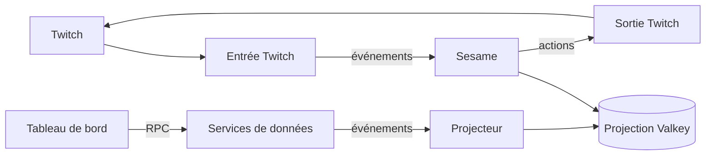

---
# Copyright (c) 2026 Adam Ousmer. All rights reserved.
# Proprietary. No license granted. See LICENSE.md.
title: Vue du système
description: "Les limites et le parcours principal des requêtes."
docType: explanation
---

## Portée et composants

ItsBagelBot reçoit les événements des plateformes, évalue le comportement du bot et renvoie des actions à la plateforme. Les diffuseurs configurent ce comportement dans le tableau de bord. Les services communiquent par NATS; les services de données possèdent leurs schémas et exposent des opérations au lieu de partager leur accès à la base.

L'entrée Twitch est en Elixir (`app/twitch/ingress`); Sesame et la sortie sont en Go (`app/twitch/sesame`, `app/twitch/outgress`). Les applications dashboard et admin sont sous `web/`. Discord possède ses propres entrée, moteur et sortie sous `app/discord`.

Ce diagramme est un point de départ, pas un graphe complet des dépendances. Voir [État du système](/fr/reference/system-overview/), [Données et état](/fr/data-and-state/) et `CONTEXT-MAP.md` à la racine. La configuration de déploiement se trouve sous `deploy/`.

## Suivre un événement dans le code

1. [L'entrée](https://github.com/AdamOusmer/ItsBagelBot/tree/main/app/twitch/ingress/) reçoit les événements Twitch et publie des messages normalisés. Les sujets et les flux distinguent les voies de trafic; voir les [définitions des flux](https://github.com/AdamOusmer/ItsBagelBot/blob/main/pkg/bus/streams.go).
2. [Sesame](https://github.com/AdamOusmer/ItsBagelBot/tree/main/app/twitch/sesame/) charge le contexte de la chaîne et applique les contrôles des modules et commandes. Une entrée absente du modèle de lecture peut nécessiter un RPC au propriétaire; le [client de projection](https://github.com/AdamOusmer/ItsBagelBot/blob/main/internal/projection/client.go) implémente ces lectures.
3. Sesame publie une action pour la [sortie](https://github.com/AdamOusmer/ItsBagelBot/tree/main/app/twitch/outgress/), qui exécute la requête vers la plateforme. L'acceptation d'un message et la réussite de l'appel Twitch sont deux résultats distincts.

Le parcours utilise des délais et une rétention limitée. Un consommateur redémarré peut reprendre le travail encore conservé, mais pas les messages expirés. Les appelants doivent traiter les dépendances indisponibles et les délais dépassés; voir [Contrats RPC](/fr/reference/rpc-contracts/) et [Projection](/fr/data-and-state/projection/).

## Modifier une fonctionnalité entre services

Commencez par le service propriétaire et son contrat sous [internal/domain](https://github.com/AdamOusmer/ItsBagelBot/tree/main/internal/domain/). Suivez le producteur ou le client RPC, le gestionnaire, le stockage et les consommateurs. Modifiez les deux côtés et leurs tests ensemble; les permissions des sujets sont dans [accounts.yaml](https://github.com/AdamOusmer/ItsBagelBot/blob/main/deploy/messaging/accounts.yaml). Gardez l'accès aux systèmes externes dans les [paquets partagés](/fr/reference/shared-packages/) et vérifiez si l'opération exige un résultat durable, un effet sûr à réessayer ou une projection jetable.
