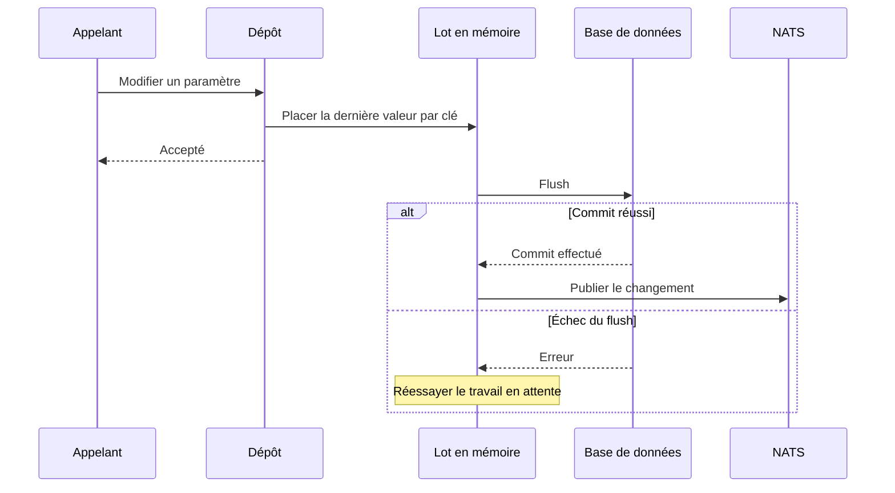

---
# Copyright (c) 2026 Adam Ousmer. All rights reserved.
# Proprietary. No license granted. See LICENSE.md.
title: Cache et écritures différées
description: "Caches de lecture, lots et limites de persistance."
docType: explanation
---

## Portée et lecture

`pkg/cache` fournit des caches locaux bornés et regroupe les chargements concurrents. Les dépôts des services de données les utilisent pour réduire les lectures; les messages d'invalidation permettent aux autres instances d'écarter leurs anciennes entrées. Les TTL et le comportement en cas d'erreur dépendent de l'appelant : consultez le dépôt concerné.

## Écriture et durabilité

`pkg/batch` regroupe les écritures en attente par clé et appelle une fonction de flush fournie par le service. Les commandes, modules et certaines préférences utilisent cette écriture différée. Les valeurs attendent en mémoire : une mise à jour acceptée peut être perdue si le processus s'arrête avant un flush réussi. Un échec est réessayé; la réponse initiale ne devient pas pour autant un commit durable. N'utilisez pas ce mécanisme pour l'argent ou les jetons.

Pour les détails d'implémentation et d'échec, consultez `pkg/batch/batcher.go`, `pkg/cache` et `app/db/<service>/repository/`. La projection est un autre modèle de lecture dérivé, décrit [séparément](/fr/data-and-state/projection/).

## Écritures simultanées

Supposons que les mises à jour A et B utilisent la même clé de lot. `Add` remplace la valeur en attente : un flush qui n'a pas encore pris la table voit B. Si A est déjà en cours de flush lorsque B arrive, B entre dans la nouvelle table. Si A échoue, le batcher ne restaure A que si aucune valeur plus récente n'attend pour cette clé; B n'est pas écrasée. Voir [`Add` et `flushPending`](https://github.com/AdamOusmer/ItsBagelBot/blob/main/pkg/batch/batcher.go) et leurs tests.

Une fermeture normale tente de vider les données en attente dans le contexte fourni. Un crash ne peut pas le faire. La fonction de flush décide de sa transaction et de la publication d'événements; vérifiez le dépôt concerné avant de supposer des effets identiques pour tous les lots.

## Échecs de lecture et invalidation

Le [client de projection](https://github.com/AdamOusmer/ItsBagelBot/blob/main/internal/projection/client.go) configure des caches locaux avec données périmées en cas d'erreur et écoute les invalidations. Utilisateurs, modules et commandes ont des caches distincts. À froid, il peut demander un instantané au propriétaire; le chemin modules utilise aussi un court délai de repli pendant une panne. Les [tests RPC](https://github.com/AdamOusmer/ItsBagelBot/blob/main/internal/projection/client_rpc_test.go) couvrent les nouvelles tentatives et l'effacement de ce délai à l'invalidation. Ces politiques sont propres à ce client.

Pour modifier une écriture mise en cache, testez la valeur locale, l'invalidation sur une autre instance, l'échec d'un rechargement et l'arrivée d'une nouvelle écriture pendant un flush échoué. Pour les données durables, choisissez un chemin direct et testez une nouvelle tentative après un délai au résultat ambigu.
