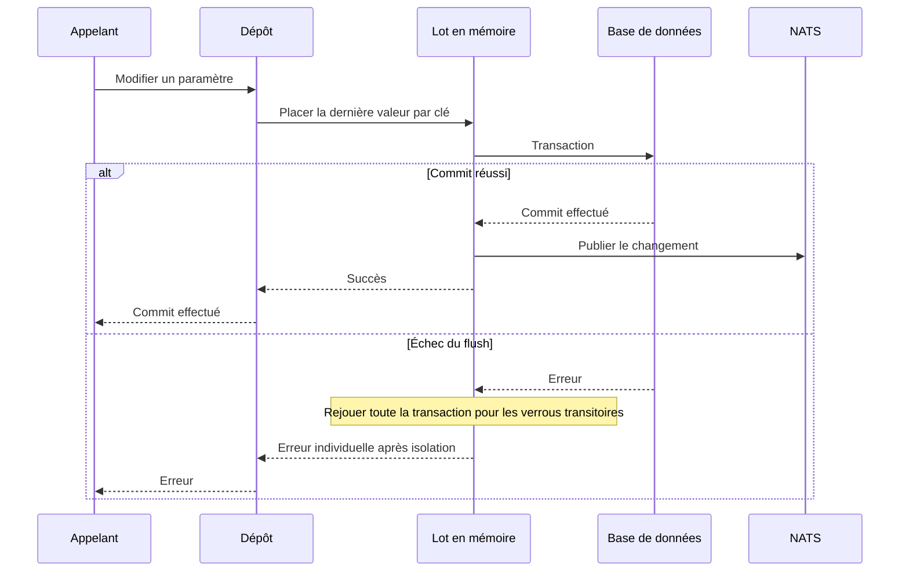

---
# Copyright (c) 2026 Adam Ousmer. All rights reserved.
# Proprietary. No license granted. See LICENSE.md.
title: Cache et écritures validées
description: "Caches de lecture, lots et limites de persistance."
docType: explanation
---

## Portée et lecture

`pkg/cache` fournit des caches locaux bornés et regroupe les chargements concurrents. Les dépôts des services de données les utilisent pour réduire les lectures; les messages d'invalidation permettent aux autres instances d'écarter leurs anciennes entrées. Les TTL et le comportement en cas d'erreur dépendent de l'appelant : consultez le dépôt concerné.

## Écriture et durabilité

`pkg/batch/group.go` regroupe les modifications de commandes et les préférences avant d'appeler une transaction fournie par le service. La réponse positive attend le commit MySQL. Les modules utilisent les opérations synchrones `SetNow` et patch. Le travail en attente reste en mémoire : un arrêt avant le commit impose une nouvelle tentative. Les événements de compteurs gardent des reçus stables pour rendre les tentatives idempotentes. Les écritures financières et les identifiants conservent leurs chemins synchrones dédiés.

Pour les détails d'implémentation et d'échec, consultez `pkg/batch/group.go`, `pkg/cache` et `app/db/<service>/repository/`. La projection est un autre modèle de lecture dérivé, décrit [séparément](/fr/data-and-state/projection/).

## Écritures simultanées

Supposons que les mises à jour A et B utilisent la même clé de groupe. Dans un même lot, la dernière valeur admise gagne et les appelants précédents partagent son résultat validé. Si B échoue avec une erreur attribuable à cet élément, l'isolation renvoie cette erreur à son appelant puis tente A. Les éléments sains peuvent toujours être validés. Des budgets de lignes et d'octets estimés bornent chaque requête; les éléments trop volumineux sont refusés avant admission. Voir [`Group`](https://github.com/AdamOusmer/ItsBagelBot/blob/main/pkg/batch/group.go) et ses tests.

Les upserts groupés de commandes et les préférences autorisent au plus 250 ms d'attente, puis une seconde pour la transaction et un budget distinct de 250 ms pour la publication, soit 1,5 seconde. Un simple upsert de commande autorise aussi 250 ms pour obtenir le verrou du diffuseur avant admission, soit 1,75 seconde au total. Ces bornes restent inférieures aux délais RPC de deux secondes pour les commandes et trois secondes pour les utilisateurs. Le renommage et la suppression utilisent le contexte appelant pour le verrou exclusif, SQL et la publication; le renommage d'une ligne absente emprunte ensuite le chemin d'upsert groupé, donc la borne du simple upsert ne couvre pas tout le renommage. Une annulation après admission ne sépare pas la réponse du résultat du commit. La publication après commit groupé reçoit un nouveau contexte; son échec n'annule pas les données validées.

Une fermeture normale tente de vider les données en attente dans le contexte fourni. Un crash ne peut pas le faire. La fonction de flush décide de sa transaction et de la publication d'événements; vérifiez le dépôt concerné avant de supposer des effets identiques pour tous les lots.

## Échecs de lecture et invalidation

Le [client de projection](https://github.com/AdamOusmer/ItsBagelBot/blob/main/internal/projection/client.go) configure des caches locaux avec données périmées en cas d'erreur et écoute les invalidations. Utilisateurs, modules et commandes ont des caches distincts. À froid, il peut demander un instantané au propriétaire; le chemin modules utilise aussi un court délai de repli pendant une panne. Les [tests RPC](https://github.com/AdamOusmer/ItsBagelBot/blob/main/internal/projection/client_rpc_test.go) couvrent les nouvelles tentatives et l'effacement de ce délai à l'invalidation. Ces politiques sont propres à ce client.

Pour modifier une écriture mise en cache, testez la valeur locale validée, l'invalidation sur une autre instance, l'échec d'un rechargement, l'isolation des éléments invalides et les modifications simultanées. Testez les nouvelles tentatives après un délai de transport ambigu selon le contrat d'idempotence de l'opération.
