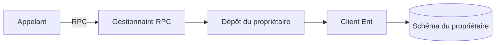

---
# Copyright (c) 2026 Adam Ousmer. All rights reserved.
# Proprietary. No license granted. See LICENSE.md.
title: Propriété des bases de données
description: "Où trouver les schémas, migrations et accès aux données."
docType: explanation
---

## Portée et propriété

Les services sous `app/db/` possèdent des schémas MySQL distincts. Les définitions Ent se trouvent dans `app/db/<service>/ent/schema/`, à côté du code Ent généré. Les dépôts et gestionnaires RPC appartiennent au même service. Pour modifier un champ, examinez ensemble son schéma, son dépôt, son DTO RPC, ses événements et ses appelants.

Les identifiants entre services relient les enregistrements par leur valeur. Ils n'autorisent pas l'accès au schéma d'un autre service. Utilisez son RPC ou son événement. La configuration partagée des connexions et des migrations se trouve dans `pkg/db`.

## Parcours d’une requête

## Durabilité et échecs

Toutes les écritures n'ont pas la même garantie de persistance. Certains paramètres passent par un lot en mémoire avant le commit; les opérations financières et les identifiants ont leurs propres chemins directs. Consultez le dépôt concerné avant de supposer qu'une réponse positive signifie que le commit est terminé. Voir [Cache et écritures différées](/fr/data-and-state/caching/).

Le démarrage configure les migrations et les identifiants; consultez `pkg/db/provider.go` et la configuration du service avant d'utiliser une base existante. Le code généré n'est pas la définition source du schéma.
