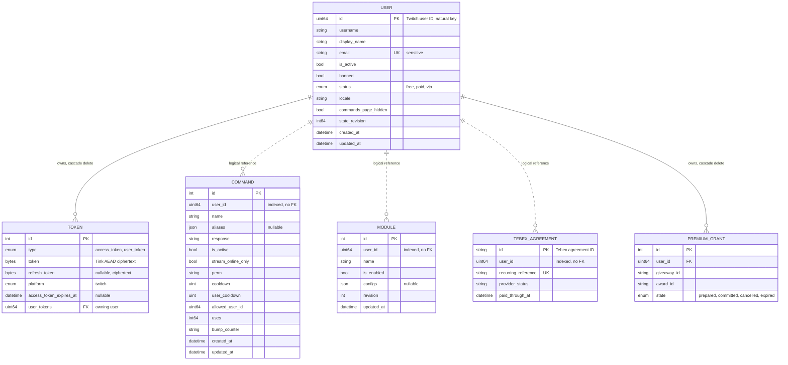
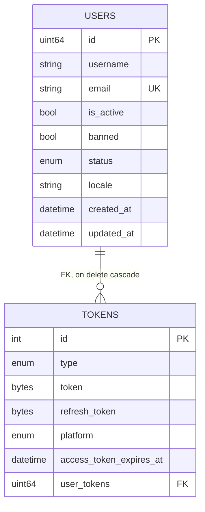
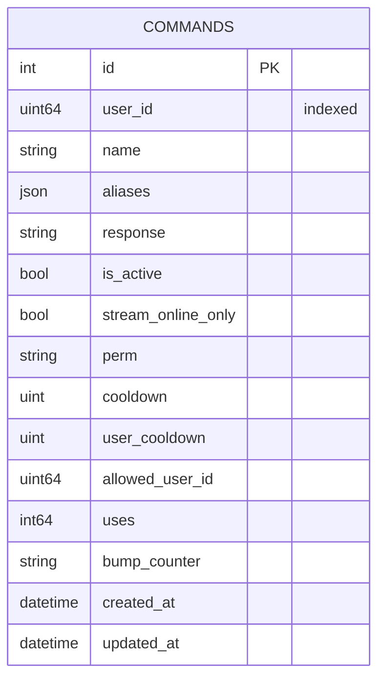
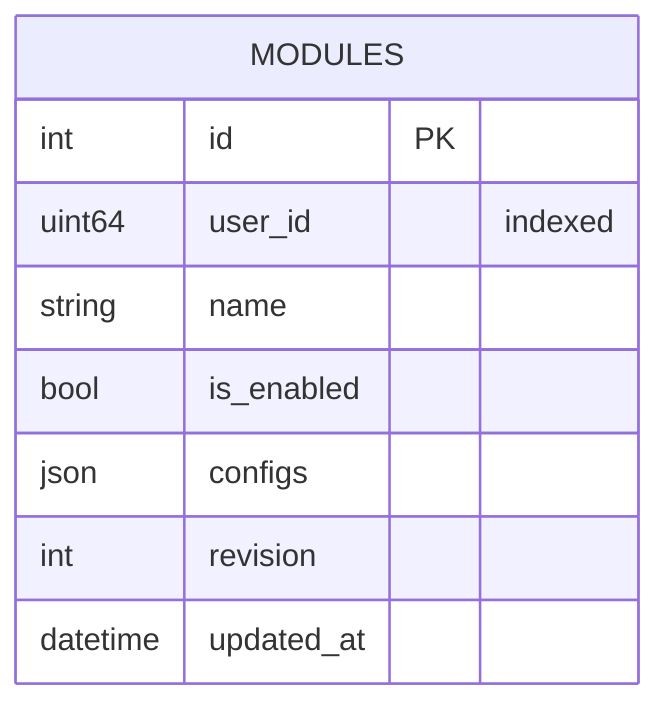
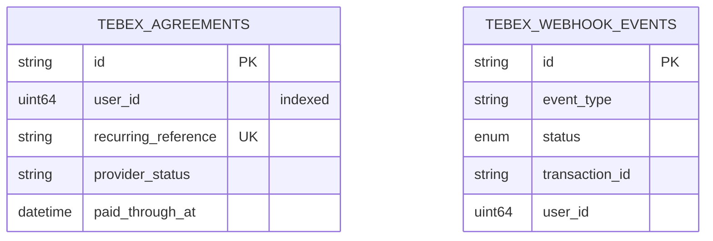

---
# Copyright (c) 2026 Adam Ousmer. All rights reserved.
# Proprietary. No license granted. See LICENSE.md.
title: Conception de la base de données
description: "Modèle conceptuel, schémas physiques par service, règles d'intégrité et argument de normalisation du plan de données."
sidebar:
  order: 2
---

La conception suit les deux étapes classiques : d'abord un modèle conceptuel entité-relation, puis sa correspondance avec les schémas relationnels physiques. La particularité est que cette correspondance est répartie entre des schémas MySQL isolés, un par service de données ([ADR 0005](/fr/adr/0005-adoption-of-mysql-heatwave/)) ; les relations qui franchissent une frontière de service n'existent que dans le modèle conceptuel et sont imposées par l'application, jamais par une clé étrangère.

## Modèle conceptuel

Notation en patte-de-corbeau. Les lignes pleines représentent des relations identifiantes imposées par une clé étrangère à l'intérieur d'un schéma ; les lignes en pointillés représentent des références logiques non identifiantes entre schémas, portées par une simple colonne d'identifiant utilisateur Twitch.

## Schémas physiques

Chaque service génère son schéma à partir de ses propres définitions ent et le migre au démarrage. Les paramètres de session sont verrouillés au niveau de la connexion plutôt que de dépendre des valeurs par défaut du serveur : `utf8mb4`, `READ COMMITTED`, mode SQL strict et UTC.

### `bagel_users` (service users)

C'est le seul schéma possédant de véritables clés étrangères, car les utilisateurs, les jetons et les octrois Premium appartiennent au même contexte délimité et évoluent ensemble (une actualisation de connexion met à jour l'utilisateur et le jeton dans une seule transaction). Les deux relations suppriment en cascade. Le diagramme montre les colonnes utiles au modèle ; `app/db/users/ent/schema/` contient l'ensemble complet, dont les champs d'abonnement, d'événements de facturation, d'intégration et de compte de test.

Index : index unique sur `email`, index composite sur `(status, subscription_source, subscription_expires_at)`, index volontairement non unique sur `username` (un renommage libère l'ancien identifiant alors que la ligne le porte encore) et index composite unique sur `(type, platform, user)`, afin qu'un utilisateur ne détienne au plus qu'un jeton par type et par plateforme. Les colonnes de jeton ne stockent que le texte chiffré AEAD de Tink ; les données associées lient chaque enveloppe à son propriétaire, à son type et à sa plateforme, de sorte qu'un texte chiffré copié sur une autre ligne échoue à l'authentification lors du déchiffrement.

### `bagel_commands` (service commands)

Le service possède aussi les définitions de fetch personnalisé et leurs étiquettes de clé (`fetchdefinition`, `fetchkey`) ainsi que les reçus de lots d'utilisation de commandes (`commandusebatch`). Index : index composite unique sur `(user_id, name)`. Il impose à la fois « un nom de commande par chaîne » et sert à la recherche par chaîne.

### `bagel_modules` (service modules)

Le service possède aussi les citations, les identifiants d'intégration et les compteurs de flux (`app/db/modules/ent/schema/`). Index : index composite unique sur `(user_id, name)`. La colonne `configs` est un JSON opaque appartenant au module qui le lit ; la base de données garantit seulement qu'il s'agit d'un JSON valide dont la taille est limitée (voir les règles d'intégrité ci-dessous).

### `bagel_transactions` (service transactions)

La facturation est idempotente par construction : les événements webhook et les accords utilisent l'identifiant du fournisseur comme clé naturelle, donc un webhook rejoué retrouve la ligne existante. Le même schéma contient le registre des concours (concours, tirages, candidats, récompenses, plans d'exécution, boîte d'envoi, alertes, baux d'utilisateur), les opérations de facturation et les e-mails de récompense. Voir l'[ADR 0011](/fr/adr/0011-transactions-owns-giveaway-winner-records/).

### Autres schémas

| Schéma | Service | Contenu |
|---|---|---|
| `bagel_loyalty` | loyalty | Soldes des spectateurs, compteurs, entrées de compteurs et reçus de lots |
| `bagel_notifications` | notifications | Enregistrements de notifications et état de lecture |
| `bagel_discord` | discord-data | Liaisons et configuration des serveurs, XP des membres, tickets et transcriptions |

## Règles d'intégrité

L'intégrité est imposée à deux niveaux. Le niveau du schéma porte ce que la base de données peut exprimer : clés primaires, contraintes d'unicité, domaines d'énumération, `NOT NULL` et les clés étrangères internes avec cascade. Le niveau applicatif (`internal/domain/validate`) porte les contraintes de domaine que la base ne peut pas exprimer ; elles sont appliquées à chaque frontière de dépôt et provoquent un rejet plutôt qu'une réécriture :

| Entrée | Règle |
|-------|------|
| Identifiant utilisateur | Non nul |
| Nom d'utilisateur | 1 à 25 caractères parmi `[a-zA-Z0-9_]` |
| E-mail | Adresse RFC 5322, 254 caractères maximum, sans nom affiché injecté ni CRLF |
| Nom de commande | 1 à 64 caractères ASCII imprimables, sans espace blanc |
| Alias de commande | 25 au maximum, chacun un nom de commande valide, uniques |
| Réponse de commande | 1 à 5 lignes, chacune de 1 à 500 caractères, sans caractère de contrôle |
| Permission de commande | L'une de `everyone`, `sub`, `vip`, `mod`, `lead_mod`, `broadcaster` |
| Délai de commande | 0 à 86400 secondes |
| Nom de module | 1 à 64 caractères parmi `[a-z0-9_-]`, règle stricte car le nom devient une partie d'un champ de hachage Valkey |
| Configuration de module | JSON valide, limite de 16 KiB |
| Jeton | De 1 octet à 8 KiB, stocké uniquement sous forme chiffrée |

ent paramètre chaque requête ; l'injection SQL est donc bloquée au niveau d'accès. Les règles ci-dessus ciblent la validité du domaine, les limites de ressources et la sécurité des clés de projection.

## Normalisation

Chaque table est en BCNF. L'argument est court parce que les schémas sont volontairement étroits :

- `users` : tous les attributs non clés dépendent uniquement de l'identifiant Twitch ; `email` est une clé candidate supplémentaire et ne détermine rien au-delà de lui-même.
- `tokens` : la clé candidate `(user, type, platform)` détermine les colonnes de texte chiffré ; l'`id` de substitution existe pour les besoins d'ent, et non pour dissimuler des dépendances.
- `commands` et `modules` : tous les attributs dépendent entièrement de la clé candidate `(user_id, name)` ; il n'existe aucune dépendance partielle ou transitive.
- `tebex_agreements` et `tebex_webhook_events` : chaque attribut dépend uniquement de l'identifiant du fournisseur, rien à décomposer.

La seule dénormalisation délibérée du système se trouve hors de MySQL : la projection Valkey duplique l'état du statut et des modules dans un modèle de lecture (voir [Projection des paramètres](/fr/data-and-state/projection/)). Cette copie est un cache, peut être reconstruite à tout moment et ne constitue jamais la source de vérité.
