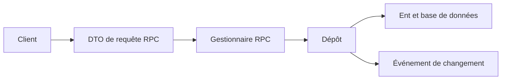

---
# Copyright (c) 2026 Adam Ousmer. All rights reserved.
# Proprietary. No license granted. See LICENSE.md.
title: Code des services de données
description: "Le parcours d’une requête dans les couches du service."
docType: explanation
---

## Portée et composants

Un service de données sépare généralement son contrat réseau, son gestionnaire et son code de persistance. Ce schéma aide à naviguer dans le code; chaque opération ne suit pas nécessairement le même chemin.

- `internal/domain/rpc/` définit les types de requête et de réponse partagés; `internal/domain/event/` définit les événements.
- `app/db/<service>/rpc/` traite les opérations. `app/db/<service>/repository/` implémente la persistance, les caches et les lots propres au service.
- `app/db/<service>/ent/schema/` définit les entités Ent. Le code Ent généré est à côté.
- `pkg/bus`, `pkg/db`, `pkg/cache` et `pkg/batch` fournissent les mécanismes partagés. Le code des services utilise ces paquets pour les systèmes dont ils sont responsables.

## Invariants et échecs

Pour modifier un contrat, suivez l'appelant, le gestionnaire, le dépôt et les consommateurs. Un transport réussi peut contenir un refus applicatif; vérifiez `error` et, s'il est fourni, `code` (`internal/domain/rpc/code.go`).

## Parcours d'un instantané utilisateur

Le [DTO de projection](https://github.com/AdamOusmer/ItsBagelBot/blob/main/internal/domain/rpc/projection/projection.go) transporte `user_id` sous forme de chaîne. Le [gestionnaire RPC users](https://github.com/AdamOusmer/ItsBagelBot/blob/main/app/db/users/rpc/projection.go) le valide, appelle le dépôt, transforme un compte absent en refus `not_found` et construit un instantané. L'[hydrateur](https://github.com/AdamOusmer/ItsBagelBot/blob/main/app/projector/hydration/hydrator.go) consomme la réponse et écrit l'état dérivé. Ni l'appelant ni le projecteur ne consulte directement le schéma users.

Cette séparation guide l'ajout d'un champ : modifiez le schéma et le dépôt du propriétaire, puis le DTO et le gestionnaire, le stockage de projection et ses lecteurs. Testez la sérialisation et les refus à la frontière, puis les données absentes ou périmées chez le consommateur. Les fichiers Ent générés suivent le schéma; voir [Tests](/fr/guides/testing/) et le workflow Go pour la génération et les vérifications.
