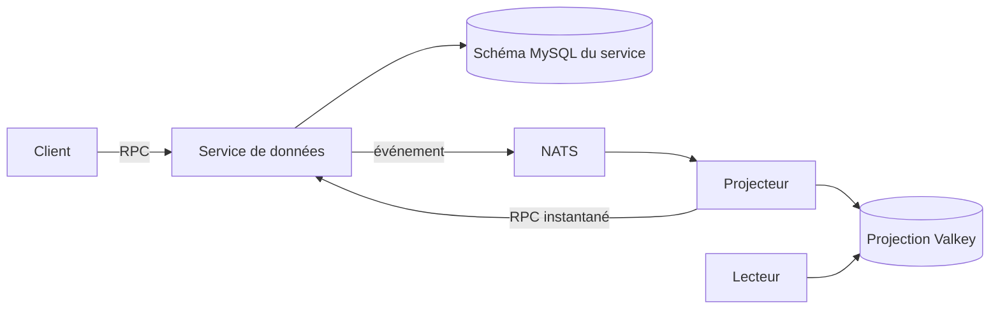

---
# Copyright (c) 2026 Adam Ousmer. All rights reserved.
# Proprietary. No license granted. See LICENSE.md.
title: Données et état
description: "La propriété et le déplacement des données applicatives."
docType: explanation
---

## Portée et parcours

Chaque service sous `app/db/` possède son schéma et expose ses opérations par NATS. Les autres services utilisent ces opérations ou consomment les événements; ils ne consultent pas les tables d'un autre propriétaire. `app/projector` maintient dans Valkey un état dérivé pour les lectures fréquentes.

## Propriété

| Propriétaire | Données principales |
| --- | --- |
| `app/db/users` | Comptes, cycle de vie, autorisations et jetons |
| `app/db/commands` | Commandes, alias et requêtes personnalisées |
| `app/db/modules` | Paramètres et données des modules |
| `app/db/loyalty` | Soldes, temps de visionnement et compteurs |
| `app/db/transactions` | Facturation, concours et récompenses |
| `app/db/notifications` | Notifications |
| `app/db/discord` | Configuration et données Discord |

Voir [Base de données](/fr/data-and-state/database/), [Cache et écritures différées](/fr/data-and-state/caching/), [Conception](/fr/data-and-state/design/) et [Projection](/fr/data-and-state/projection/). Les événements sont définis dans `internal/domain/event/data` et les flux dans `pkg/bus/streams.go`. Un consommateur durable ne reprend que les messages encore conservés; le flux n'est pas un journal permanent.
