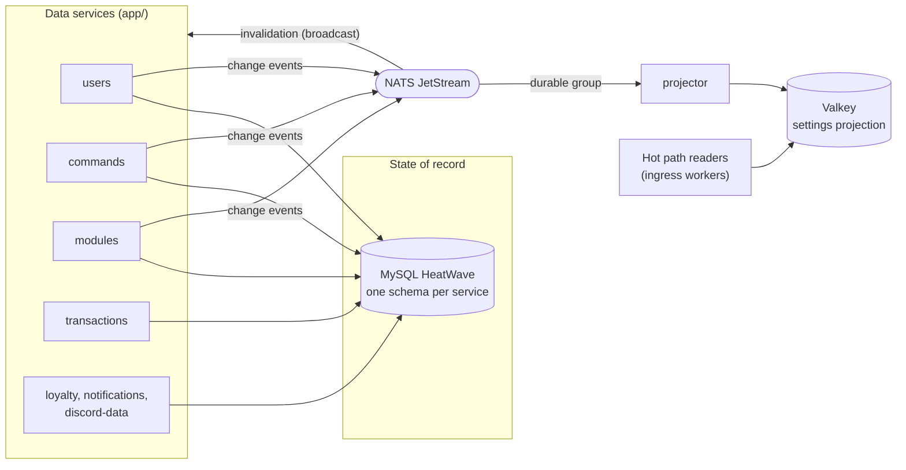

---
# Copyright (c) 2026 Adam Ousmer. All rights reserved.
# Proprietary. No license granted. See LICENSE.md.
title: Vue d'ensemble du plan de données
description: "Les services de données, leurs responsabilités et la circulation de l'état entre MySQL, les caches, NATS et la projection Valkey."
sidebar:
  order: 1
---

Le plan de données regroupe sept services à contexte borné et un projector, tous sous `app/`. Chaque service possède son propre schéma MySQL sur HeatWave ([ADR 0005](/fr/adr/0005-adoption-of-mysql-heatwave/)). Les services users, commands et modules annoncent chaque changement validé comme un événement sur NATS ([ADR 0003](/fr/adr/0003-adoption-of-nats-as-communication-bridge/)), puis le projector agrège ces événements dans la projection des réglages Valkey lue par le hot path.

Cette page présente la vue des composants. Le reste de la section approfondit :

- [Conception de la base](/fr/data-and-state/database/) : modèle conceptuel, schémas physiques et règles d'intégrité.
- [Cache et write-behind](/fr/data-and-state/caching/) : chemins de lecture et d'écriture, avec leurs diagrammes UML de séquence et d'état.
- [Conception des classes](/fr/data-and-state/design/) : diagrammes UML de classes et patterns utilisés.
- [Projection des réglages](/fr/data-and-state/projection/) : organisation Valkey et protocole de reconstruction.

## Diagramme des composants

## Propriété

| Service | Schéma | Données détenues | Chemin d’écriture |
|---------|--------|------|------------|
| `app/db/users` | `bagel_users` | Comptes (identifiant Twitch, nom, e-mail, statut, bannissement, langue, état d’abonnement, personnel et délégations, octrois Premium) et jetons OAuth chiffrés par Tink AEAD | Statut, bannissement et jetons en direct ; préférences (activation, langue, curseur, intégration, code créateur) en écriture différée |
| `app/db/commands` | `bagel_commands` | Commandes de chat personnalisées, alias, totaux d’utilisation, définitions et clés de fetch personnalisé | Écriture différée (suppressions directes) |
| `app/db/modules` | `bagel_modules` | Activation des modules et configurations JSON, citations, identifiants d’intégration, compteurs de flux | Écriture différée |
| `app/db/loyalty` | `bagel_loyalty` | Soldes des spectateurs, temps de visionnage, compteurs et entrées de chaîne | Par lots, idempotent grâce aux reçus |
| `app/db/transactions` | `bagel_transactions` | Accords et événements webhook Tebex, opérations de facturation, concours, tirages, récompenses et e-mails de récompense | Direct, idempotent lors des nouvelles tentatives |
| `app/db/notifications` | `bagel_notifications` | Enregistrements de notifications destinées aux comptes | Direct |
| `app/db/discord` | `bagel_discord` | Liaisons et configuration des serveurs, tickets, transcriptions, XP des membres | Direct |
| `app/projector` | aucun | Projection Valkey (jetable, reconstructible) | Remplacements déclenchés par événement |

Les références entre services sont de simples colonnes indexées contenant l’identifiant utilisateur Twitch. Par construction, aucune clé étrangère ne traverse les schémas.

## Contrats d'événements

Les sujets et DTO de contenu résident dans `internal/domain/event/data` et constituent un contrat public : renommer un sujet ou réduire son contenu est un changement incompatible. Les événements de changement transportent le nouvel état complet (transfert d’état par événement), de sorte que les consommateurs ne lisent jamais le schéma d’un autre service et que la relivraison est sans danger.

| Sujet | Contenu | Moment de publication |
|---------|---------|----------------|
| `data.users.changed` | identifiant, nom, activation, statut, bannissement, langue, page de commandes masquée, révision d’état, incarnation du compte | Inscription, renommage, changement de statut, de bannissement, de langue ou de préférence |
| `data.users.deleted` | identifiant utilisateur, incarnation du compte et heure de suppression | Suppression de l’utilisateur |
| `data.modules.changed` | identifiant utilisateur, nom du module, activation, configuration JSON, révision | Chaque ligne de module enregistrée lors d’un vidage |
| `data.commands.changed` | identifiant utilisateur, nom, alias, réponse, activation, restriction au direct, permissions, délais, utilisateur autorisé, utilisations, compteur associé, indicateur de suppression | Chaque ligne de commande enregistrée lors d’un vidage, et les suppressions |
| `data.commands.fetch_changed` | identifiant utilisateur, nom du fetch, URL, chemin JSON, étiquette de clé, activation, indicateur de suppression | Une définition de fetch personnalisé change |
| `data.commands.used` | identifiant utilisateur, nom de la commande, nombre | Rapports d’utilisation de commandes par lots |
| `data.loyalty.earned`, `data.loyalty.counters` | gains des spectateurs et incréments de compteurs | Sesame rapporte l’activité |
| `data.twitch.clip.created` | identifiant du diffuseur, identifiant du clip, URL | Un clip est créé |
| `data.reproject.request` | vide | Démarrage à froid du projector ; les propriétaires rejouent leur état sous forme d’événements de changement ordinaires |

Tous les sujets `data.>` sont capturés par le flux JetStream `BAGEL_DATA` (rétention de 5 minutes, stockage sur fichier, trois réplicas, `pkg/bus/streams.go`).

Deux formes d’abonnement sont utilisées délibérément :

- **Broadcast (sans groupe de file) :** invalidation du cache. Chaque instance d'un service supprime ses clés mises en cache lorsqu'une instance écrit.
- **Groupe de file durable :** le projector et les répondants de reproject. Un seul consommateur par groupe traite chaque événement, et le groupe conserve sa position après un redémarrage.

Les consommateurs valident chaque contenu et **abandonnent** (journalisation et acquittement) ce qui ne peut pas être décodé ou validé. Un acquittement négatif sur un message invalide entraînerait sa relivraison indéfinie.

## Configuration

Chaque service lit sa configuration dans l’environnement. Variables communes :

| Variable | Valeur par défaut | Utilisation |
|----------|---------|---------|
| `APP_ENV` | `development` | tous (profil du logger) |
| `NATS_URL` | `nats://127.0.0.1:4222` | tous |
| `DB_ADDR` | `127.0.0.1:3306` | services de données |
| `DB_USER`, `DB_PASS` | obligatoires | services de données |
| `DB_SCHEMA` | `bagel_<service>` | services de données |
| `DB_CA_CERT` | obligatoire | services de données ; certificat CA PEM de HeatWave épinglé (`pkg/db/provider.go`) ; le démarrage échoue s’il est absent ou invalide |
| `DB_TLS_MODE` | `VERIFY_CA` | services de données ; `pkg/db/provider.go` |
| `DB_AUTO_MIGRATE` | `true` | services de données ; exécute la migration du schéma ent au démarrage |
| `DB_ADMIN_CA_CERT` | repli sur `DB_CA_CERT` | console admin ; certificat CA PEM de HeatWave pour la connexion privilégiée d’administration des schémas (`web/admin/src/lib/server/secrets.ts`) |
| `TINK_KEYSET_PATH` | obligatoire pour users ; facultatif pour commands et modules (la garde des clés est désactivée avec un avertissement en son absence) | users, commands, modules |
| `VALKEY_ADDR` | `127.0.0.1:6379` | services qui utilisent Valkey (`pkg/svcboot/infra.go`) |
| `VALKEY_PASSWORD` | vide | services qui utilisent Valkey |
| `NEW_RELIC_LICENSE_KEY` | vide (supervision désactivée) | tous |

Sans clé de licence, la supervision ne fait rien : le développement local n’a donc besoin d’aucune variable `NEW_RELIC_*`.
