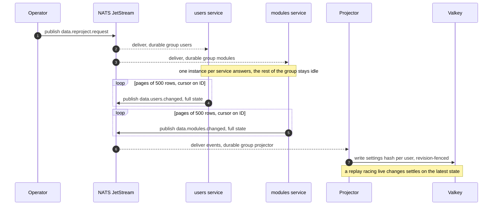

---
# Copyright (c) 2026 Adam Ousmer. All rights reserved.
# Proprietary. No license granted. See LICENSE.md.
title: Projection des réglages
description: "Modèle de lecture Valkey : organisation des hashes, flux d'événements et handshake de reproject qui reconstruit l'état."
sidebar:
  order: 5
---

Le hot path réagit à un message de chat et cette lecture ne peut pas toucher MySQL. Le projector (`app/projector`) maintient dans Valkey un modèle de lecture dénormalisé contenant tout ce dont le hot path a besoin sur une chaîne, lisible en un aller-retour. La projection est un cache, jamais la source de vérité ; MySQL peut la reconstruire à tout moment. L'organisation des clés se trouve dans `internal/projection`.

## Organisation

Un hash par utilisateur, `settings:<user_id>`, lisible avec un seul `HGETALL`. Le TTL par défaut est de 24 heures, et une écriture ne raccourcit jamais un TTL existant plus long.

```
settings:<user_id>
  status                   free | paid | vip
  active                   0 | 1
  banned                   0 | 1
  locale                   langue de l'interface
  commands_page_hidden     0 | 1
  live                     0 | 1
  live_ver                 version de l'indicateur live
  module:<name>:enabled    0 | 1
  module:<name>:config     JSON brut
  module:<name>:revision   jeton de concurrence optimiste
  modules:projected        marqueur : la section des modules est complète
  command:<name>           vue JSON de la commande
  cmdalias:<alias>         pointeur vers la commande
  commands:projected       marqueur : la section des commandes est complète
  fetch:<name>             définition de fetch personnalisé
  fetches:projected        marqueur : la section des fetch est complète
  stream:*, streamctr:*    titre, jeu, spectateurs et compteurs par stream
```

Les lecteurs n'analysent que le champ dont ils ont réellement besoin. Les noms de module sont validés à la frontière d'écriture (lettres minuscules, chiffres, tiret bas, tiret) précisément parce que le nom est intégré au champ : un deux-points dans un nom pourrait sinon forger un autre champ. Un marqueur `*:projected` distingue une section vide d'une section jamais chargée, si bien qu'une liste de commandes vide ne déclenche pas de lectures répétées chez le propriétaire.

D'autres clés accompagnent le hash : un enregistrement d'admission par utilisateur qui porte l'incarnation du compte et les barrières de révision, ainsi que les clés de compteurs en direct et de classements (`ctr:live:<id>`, `ctr:board:v2:<name>`). Sesame possède la clé versionnée `live:<id>` ; le projector ne l'écrit jamais.

## Flux en direct

Le projector consomme les événements de changement des utilisateurs, modules et commandes, les événements de compteurs de fidélité et les événements d'état de stream via un groupe de files durable : chaque événement est donc appliqué une fois et le consommateur conserve sa position après un redémarrage. Chaque handler valide le contenu, puis l'écrit via un script qui vérifie l'incarnation du compte et la révision : un événement obsolète ou rejoué ne peut pas écraser un état plus récent, et les anciens événements d'un compte supprimé ne peuvent pas le faire revivre. La suppression d'un utilisateur marque le compte comme supprimé et retire le hash. L'invalidation du cache n'est publiée qu'après la réussite de l'écriture dans le magasin.

## Reconstruction et réparation

Une section absente ou expirée converge sans que le projector lise jamais le schéma d'un autre service :

- **Hydratation.** Quand une lecture trouve une section absente, l'hydrateur du projector récupère l'instantané du propriétaire via les sujets `bagel.rpc.internal.projection.*` et écrit la section. Les récupérations sont bornées (8 simultanées par défaut, `PROJECTOR_HYDRATION_CONCURRENCY` ; trois tentatives chacune) et limitées par utilisateur. L'hydratation déclenchée par une requête conserve la section 2 heures (`PROJECTOR_QUERY_HYDRATION_TTL`) ; celle du passage en direct utilise la valeur par défaut de 24 heures. Le passage en direct déclenche aussi un rafraîchissement complet.
- **Handshake de reproject.** Publier `data.reproject.request` fait rejouer chaque ligne par les services users et modules comme un événement de changement ordinaire, paginé pour ne jamais charger une table entière. Le projector ne publie pas cette requête lui-même ; aucun service du dépôt ne le fait aujourd'hui, et le rôle `admin_bus` peut la publier (`deploy/messaging/accounts.yaml`).



Le handshake sert aussi d'outil de réconciliation : si un événement est un jour manqué au-delà de la fenêtre de rétention JetStream ([ADR 0003](/fr/adr/0003-adoption-of-nats-as-communication-bridge/)), la projection reste périmée pour l'utilisateur concerné seulement jusqu'au prochain changement, à la prochaine hydratation ou au prochain reproject.

## Comportement en cas de panne

- **Valkey indisponible :** aucune donnée n'est perdue ; les sections s'hydratent de nouveau depuis les propriétaires au retour de Valkey. Les lecteurs du hot path doivent se dégrader de façon délibérée pendant l'absence, ce qui relève de leur décision et non de celle du projector.
- **Projector indisponible :** le groupe durable conserve sa position ; au redémarrage, il reprend là où il s'était arrêté, dans la fenêtre de rétention.
- **Événement empoisonné :** validé, journalisé et acquitté. La projection ne se bloque jamais sur un message mal formé. Les échecs de stockage renvoient une erreur afin que l'événement soit relivré.
- **Pourquoi Valkey et non Redis :** même protocole, mêmes clients, même modèle de données ; Valkey est le fork sous licence BSD à gouvernance ouverte, ce qui compte pour un logiciel potentiellement autohébergé indéfiniment sur la flotte décrite dans l'[ADR 0004](/fr/adr/0004-adoption-of-oracle-cloud/).
