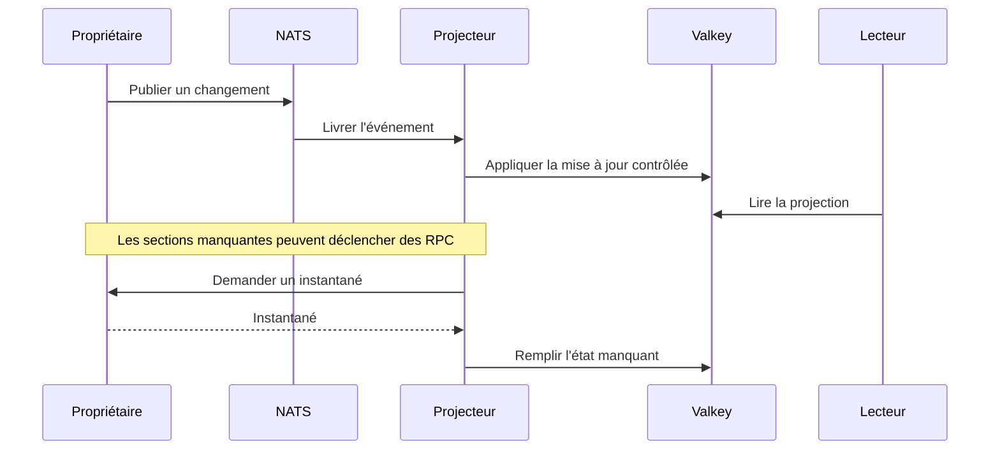

---
# Copyright (c) 2026 Adam Ousmer. All rights reserved.
# Proprietary. No license granted. See LICENSE.md.
title: Projection des paramètres
description: "Le modèle de lecture dérivé dans Valkey et ses chemins de récupération."
docType: explanation
---

## Portée et composants

`app/projector` maintient un modèle de lecture dérivé dans Valkey. Les opérations sur ses clés et champs sont dans `internal/projection/`; les services de données restent propriétaires des enregistrements persistés. Les lecteurs peuvent demander des instantanés par les contrats RPC dans `internal/domain/rpc/projection/`.

Le hash `settings:<user_id>` contient l'état utilisateur et des sections pour les modules, commandes et fetches. Des marqueurs distinguent une section vide d'une section non projetée. Des clés associées d'admission et de révision protègent le cycle de vie et les mises à jour versionnées. Les lectures d'admission à l'exécution utilisent le primaire; voir `internal/projection/runtime.go`.

## Invariants et échecs

Le projecteur consomme les changements et applique les contrôles de révision et d'incarnation du compte là où ils sont implémentés. Une livraison peut être répétée; ne supposez pas un traitement exactement une fois. L'hydratation dans `app/projector/hydration/` obtient les instantanés des utilisateurs, modules et commandes par RPC, borne la concurrence et les tentatives et contrôle le travail par utilisateur. Les lectures et les rafraîchissements au passage en direct ont des TTL distincts. Consultez le code et la configuration pour les valeurs actuelles.

L'événement `data.reproject.request` demande aux propriétaires de rejouer leur état; le projecteur ne l'émet pas lui-même. Un événement conservé peut être livré de nouveau après un échec, mais la rétention est limitée. Après une panne plus longue, la réparation dépend de l'hydratation, de changements ultérieurs ou d'un rejeu demandé explicitement. Une panne Valkey peut rendre les lectures indisponibles; la récupération ne garantit pas que chaque compteur dérivé peut être reconstruit par les propriétaires des paramètres. Examinez chaque gestionnaire et ses erreurs de stockage avant de modifier ce comportement.

## Lecture à froid et récupération

Le [client de projection](https://github.com/AdamOusmer/ItsBagelBot/blob/main/internal/projection/client.go) possède des caches locaux pour utilisateurs, modules, commandes et fetches. En cas d'absence, il consulte le stockage et peut demander un instantané au propriétaire par NATS. Ses caches peuvent servir des données périmées en cas d'erreur; les échecs RPC des modules déclenchent aussi un court délai de repli. Ce chemin est distinct de l'hydratation asynchrone du projecteur. Les [tests RPC](https://github.com/AdamOusmer/ItsBagelBot/blob/main/internal/projection/client_rpc_test.go) couvrent erreurs, nouvelles tentatives et invalidation.

L'[hydrateur](https://github.com/AdamOusmer/ItsBagelBot/blob/main/app/projector/hydration/hydrator.go) demande des instantanés avec une concurrence bornée, jusqu'à trois tentatives et des contrôles par utilisateur. Une lecture peut fournir des données de modules ou commandes déjà connues; un rafraîchissement au passage en direct force une nouvelle exécution. Une requête échouée ne rend pas un hash partiel complet. Les marqueurs permettent de distinguer « non chargé » de « chargé et vide ».

## Modifier un champ projeté

1. Modifiez le DTO du propriétaire dans les [contrats de projection](https://github.com/AdamOusmer/ItsBagelBot/blob/main/internal/domain/rpc/projection/projection.go), son gestionnaire et, le cas échéant, l'événement de changement correspondant.
2. Modifiez la représentation lue et écrite sous [internal/projection](https://github.com/AdamOusmer/ItsBagelBot/tree/main/internal/projection/), ainsi que le gestionnaire ou l'hydratation du projecteur. Préservez les contrôles de révision et d'incarnation appropriés.
3. Adaptez les consommateurs et les tests pour une section vide, une mise à jour périmée ou rejouée et une panne du propriétaire ou de Valkey. Vérifiez une lecture à froid et un changement après hydratation.

Le flux d'événements n'est pas la base de données : [DATA](https://github.com/AdamOusmer/ItsBagelBot/blob/main/pkg/bus/streams.go) a une rétention limitée. Un hash sain reste un état dérivé qui peut avoir du retard pendant la livraison ou l'hydratation.
