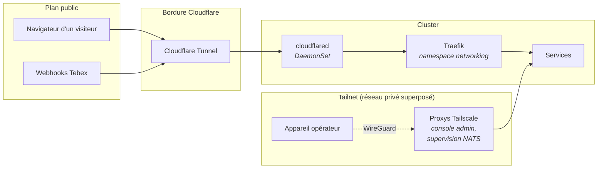

---
# Copyright (c) 2026 Adam Ousmer. All rights reserved.
# Proprietary. No license granted. See LICENSE.md.
title: Réseau
description: Entrée par Cloudflare Tunnel, accès privé par Tailscale, Cilium et le modèle de refus par défaut qui relie le cluster.
---

Le trafic public n'atteint le cluster que par un Cloudflare Tunnel sortant. L'accès des opérateurs passe par Tailscale. Dans le cluster, chaque namespace part d'une politique réseau de refus par défaut et n'ouvre que les chemins nécessaires. Aucune connexion n'obtient de confiance par sa seule position sur le réseau.

La décision d'hébergement et de tailnet figure dans l'[ADR 0004](/fr/adr/0004-adoption-of-oracle-cloud/) ; cette page sert de référence opérationnelle.

## Les deux plans

- **Plan public (Cloudflare) :** tout ce qui doit être joint par une partie que nous ne contrôlons pas, comme les diffuseurs qui ouvrent le tableau de bord et Tebex qui envoie ses webhooks d'achat. Les événements Twitch n'arrivent pas par là : l'ingress ouvre des connexions WebSocket EventSub sortantes.
- **Plan privé (Tailscale) :** l'accès des opérateurs à la console d'administration, à la supervision NATS et à l'API Kubernetes.

## Cloudflare Tunnel : l'entrée publique

`cloudflared` tourne en DaemonSet sur chaque nœud sauf le plan de contrôle (`deploy/operators/cloudflared.yaml`). Chaque règle d'entrée redirige vers le Service Traefik du namespace `networking` en TLS. Le connecteur ne fait confiance qu'à l'autorité Cloudflare Origin CA et force le SNI sur le domaine racine de la zone, de sorte que le routage ne dépend jamais des noms d'hôte publics existants.

### Services exposés

| Nom d'hôte | Rôle |
| --- | --- |
| `dashboard.itsbagelbot.com` | La console des diffuseurs (SvelteKit). Les routes `/status`, `/healthz` et `/readyz` de l'application sont masquées par Traefik. |
| `stats.itsbagelbot.com` | La page publique de statistiques. |
| `commands.itsbagelbot.com`, `leaderboard.itsbagelbot.com` | Pages publiques de commandes et classements, servies par l'application du tableau de bord via la règle générique. |
| `health.itsbagelbot.com` | Points `/status` par service lus par la page d'état hébergée (`deploy/k8s/status-routes.yaml`). |
| `webhooks.itsbagelbot.com` | Webhooks Tebex vers le service transactions. |
| `itsbagelbot.com` et `*.itsbagelbot.com` | Tout le reste de la zone. Traefik décide du routage, et les hôtes sans route retombent sur le site marketing. |

`status.itsbagelbot.com` est la page d'état hébergée elle-même. Son DNS pointe vers le fournisseur d'état, donc le tunnel ne la revendique pas.

La configuration du tunnel se termine par la règle obligatoire `http_status:404`.

### Pourquoi un tunnel

Un tunnel garde les nœuds hors de l'internet public et apporte la terminaison TLS en bordure et l'absorption des attaques DDoS pour le récepteur de webhooks public. Tebex dispose d'une URL de webhook stable et de marque plutôt que d'une adresse de nœud.

## Tailscale : le réseau privé superposé

L'opérateur Kubernetes de Tailscale publie certains Services sur le tailnet via des ressources Ingress avec `ingressClassName: tailscale` :

| Service | Où il est défini |
| --- | --- |
| Console d'administration | `deploy/k8s/console-admin.yaml` |
| Supervision NATS | `deploy/messaging/nats.yaml` |
| Tableau de bord Traefik et interface Falco | Autorisés par `deploy/networking/network-policies.yaml` et `deploy/observability/network-policies.yaml` |

La console d'administration n'a donc aucun nom d'hôte public. Les opérateurs l'atteignent uniquement depuis un appareil du tailnet.

La configuration Cilium pointe l'adresse du serveur d'API Kubernetes vers une adresse du tailnet (`deploy/cilium/values.yaml`). La politique du tailnet elle-même n'est pas stockée dans ce dépôt.

## Dans le cluster

- **CNI :** Cilium en mode de routage natif avec remplacement de kube-proxy, gestion de bande passante BBR et BIG TCP (`deploy/cilium/values.yaml`).
- **Politiques réseau :** chaque namespace porte une politique de refus par défaut et des autorisations explicites (`deploy/*/network-policies.yaml`, `deploy/k8s/network-policies.yaml`). Les chemins entre namespaces nomment le namespace source et les étiquettes de pod.
- **Transport entre services :** NATS porte tout le trafic interservices ([ADR 0003](/fr/adr/0003-adoption-of-nats-as-communication-bridge/)). Valkey et NATS utilisent TLS avec des certificats émis par cert-manager (`deploy/cache/certificates.yaml`, `deploy/messaging/certificates.yaml`). La connexion MySQL épingle l'autorité de HeatWave via `DB_CA_CERT`. Traefik rechiffre vers la console du tableau de bord, donc ce saut est en TLS de bout en bout.
- **Secrets :** l'opérateur Doppler synchronise les secrets dans les namespaces qui en ont besoin (ressources `DopplerSecret` à côté de chaque charge).

## Ce qui est volontairement absent

- **Une entrée par le LAN.** Aucun Service `NodePort` ou `LoadBalancer` n'existe dans `deploy/`.
- **Un concentrateur VPN dans le cluster.** Tailscale est le VPN ; nous n'en exécutons pas un second.

## Pour aller plus loin

- **[Matériel et cluster →](/fr/infrastructure/hardware-and-cluster/)** : ce que sont les nœuds et comment K3s est organisé.
- **[ADR 0004 →](/fr/adr/0004-adoption-of-oracle-cloud/)** : la décision d'hébergement et de tailnet.
