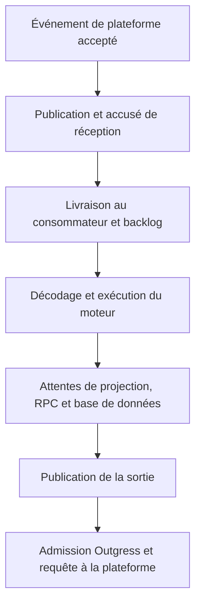

---
# Copyright (c) 2026 Adam Ousmer. All rights reserved.
# Proprietary. No license granted. See LICENSE.md.
title: Examiner la latence
description: Suivre une requête dans le code et distinguer l’attente de l’exécution.
docType: how-to
---

Une réponse lente peut attendre une tâche ou une dépendance, ou passer du temps à s’exécuter. Identifiez d’abord la frontière concernée. Ajouter des spans dans le moteur n’expliquera pas une file déjà engorgée.

## Prérequis et résultat attendu

Choisissez une opération lente, une période et le service ou la voie concernés. Il faut accéder aux journaux et aux mesures pertinents; les traces distribuées exigent une surveillance configurée. Sans licence, l'application peut fonctionner, mais aucune trace New Relic n'est attendue. Notez le symptôme et une mesure de référence avant de modifier l'instrumentation.

## 1. Vérifier l’instrumentation disponible

Vérifiez si la surveillance du service est configurée, puis examinez ses journaux et traces disponibles pour l’opération choisie. Les services Go démarrent la surveillance par `pkg/svcboot`. `pkg/monitor.New` ne renvoie aucune application si `NEW_RELIC_LICENSE_KEY` est absent : l’exécution locale et les tests ne nécessitent donc pas de compte d’observabilité.

`pkg/monitor` ajoute aux journaux les métadonnées de l’entité et les identifiants de trace et de span lorsqu’une transaction existe. Il désactive la transmission des journaux par l’agent, exclut les attributs des requêtes et réponses ainsi que les URL HTTP, et désactive la capture des requêtes brutes et des paramètres de base de données. `ScrubError` conserve un préfixe d’erreur de longueur limitée et le type. Ces contrôles réduisent les données capturées; ils ne justifient pas l’ajout de jetons ou de corps de message aux champs de journal.

`pkg/bus/telemetry.go` propage les traces à travers le bus. Préservez le contexte du gestionnaire lors des appels aux dépendances afin que le segment suivant puisse appartenir à la même requête.

## 2. Localiser la frontière lente

Suivez l’événement à travers ces frontières et repérez où le temps écoulé ou le backlog augmente en premier.

| Symptôme | Où commencer dans le code |
| --- | --- |
| L’entrée est acceptée mais le travail arrive en retard | Dispatcheur Ingress, producteur du bus, backlog du consommateur |
| Les requêtes à froid sont plus lentes | `internal/projection`, hydratation du Projector et RPC vers le propriétaire |
| Le travail de base de données attend avant une requête | `pkg/db/gate.go`, paramètres du pool et `pkg/db/stats.go` |
| La sortie revient sans cesse pour une nouvelle tentative | Gestion des livraisons dans `pkg/bus` et décisions du limiteur Outgress |
| L’effet HTTP est lent | Transport Outgress ou Gossip, état du service en amont et traitement de la réponse |

L’attente du pool, l’attente de la porte du processus et la durée d’une requête sont des mesures distinctes. Un échec de cache n’est pas automatiquement une erreur. Un accusé de réception ne prouve pas que Twitch a affiché un message.

Utilisez des noms d’opérations, des sujets et des classes de résultats bornés. Les identifiants de diffuseurs, corps de messages, jetons, URL arbitraires et clés de cache ne doivent pas figurer dans les noms de métriques.

## 3. Vérifier et comparer

Exécutez les tests ciblés de la frontière modifiée. `pkg/bus/telemetry_test.go` couvre le transport des traces et `pkg/monitor/scrub_test.go` couvre l’assainissement. Maintenez le fonctionnement sans licence. Si vous annoncez une amélioration de latence, joignez la charge de travail et le commit qui l’ont produite; un nouveau span ne prouve aucune amélioration à lui seul.

Voir [performance](/fr/infrastructure/performance/) et [tests](/fr/guides/testing/).

Sources : [monitor](https://github.com/AdamOusmer/ItsBagelBot/tree/main/pkg/monitor), [télémétrie du bus](https://github.com/AdamOusmer/ItsBagelBot/blob/main/pkg/bus/telemetry.go), [métriques du pool de base de données](https://github.com/AdamOusmer/ItsBagelBot/blob/main/pkg/db/stats.go).

## Résoudre les problèmes et documenter

Si une trace manque, vérifiez que la surveillance est activée et que le gestionnaire transmet son contexte au bus et aux dépendances. Utilisez les journaux et les mesures aux frontières en l'absence de trace; ne déduisez pas une attente en file de la seule latence totale. Comparez la même opération et la même période avant et après une modification; indiquez le commit, la charge, la taille de l'échantillon, les erreurs et la distribution des latences. Précisez les frontières mesurées et celles qui restent inconnues. Poursuivez avec [Mesurer les performances](/fr/infrastructure/performance/) lorsqu'une charge reproductible est disponible.
