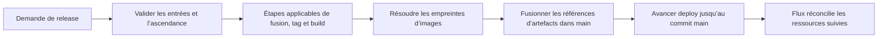

---
# Copyright (c) 2026 Adam Ousmer. All rights reserved.
# Proprietary. No license granted. See LICENSE.md.
title: Code des releases
description: Comment le train de release transforme un commit de main en artefacts déployables épinglés.
docType: explanation
---

Le comportement des releases est lui aussi défini dans le code. `app/release` est un CLI Go et `.github/workflows/release.yml` exécute ses étapes dans des jobs distincts. La console d’administration peut lancer le workflow; elle ne devient pas une seconde implémentation des releases.

## Entrées et état

Le CLI accepte `release`, `hotfix`, `bump`, `rollback` et `reapply`. Ses options comprennent la version, le SHA cible sur main, les PR à fusionner, les services sélectionnés et le chemin d’un fichier JSON de changelog. `-stage` exécute une seule étape. `-state` choisit le fichier d’état du run; un fichier existant est repris au lieu d’être initialisé à nouveau.

`internal/domain/rpc/deploy` définit le contrat partagé du run. `app/release/internal/train` pilote son exécution. Des interfaces isolent les opérations GitHub, registre et horloge de l’orchestration afin que les tests du train et des étapes puissent utiliser des doubles.



Les étapes exactes dépendent du type de run. Consultez `app/release/internal/stages/github` et le workflow avant de modifier cette sélection.

## Contrat des branches

`main` porte les modifications des références d’artefacts. `deploy` pointe vers un commit de main et avance par fast-forward, sans commit de promotion distinct. Un rollback crée une nouvelle modification des références sur main et promeut ce commit; il ne rembobine pas l’historique de deploy. Reapply doit aussi respecter les vérifications d’ascendance.

Ce contrat permet de relier l’état déployé au code source et aux références examinés. Une modification directe de la branche deploy rompt le modèle de release même si les fichiers semblent corrects.

## Modifier le train

Commencez par `app/release/main.go`, les tests du train et ceux des étapes. Utilisez des doubles pour modifier l’orchestration. Un vrai lancement du CLI peut fusionner des PR, créer des tags, publier des images et déplacer une branche : ce n’est pas un test local sans effets.

```sh
go test ./app/release/...
```

La topologie de déploiement et les identifiants des fournisseurs sont distincts de la machine à états des releases. Cette page décrit le contrat du code plutôt qu’une disposition de cluster particulière.

Sources : [CLI de release](https://github.com/AdamOusmer/ItsBagelBot/tree/main/app/release), [workflow](https://github.com/AdamOusmer/ItsBagelBot/blob/main/.github/workflows/release.yml).

## Échec, reprise et validation

Le [train](https://github.com/AdamOusmer/ItsBagelBot/blob/main/app/release/internal/train/train.go) enregistre chaque tentative comme en cours, réussie, ignorée ou échouée. Une erreur marque l'étape et le run en échec; le pilote s'arrête. Lors d'une reprise, les étapes réussies ou ignorées ne sont pas relancées. Avant l'exécution, le contrôle `Done` peut reconnaître un travail déjà terminé. Le fichier d'état conserve la progression de l'orchestration; examinez aussi l'état externe de GitHub et du registre avant de réessayer une opération interrompue.

`go test ./app/release/...` exécute les tests du train et des étapes sans lancer une vraie release. Le [workflow](https://github.com/AdamOusmer/ItsBagelBot/blob/main/.github/workflows/release.yml) et les implémentations des étapes définissent les étapes de chaque requête. Une promotion terminée avance l'état Git; la réconciliation par Flux est un résultat distinct à vérifier séparément.
