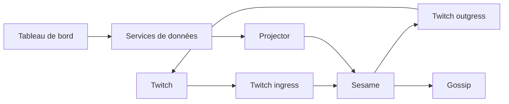

---
# Copyright (c) 2026 Adam Ousmer. All rights reserved.
# Proprietary. No license granted. See LICENSE.md.
title: Services
description: Responsabilités des services et emplacement du code.
docType: reference
---

ItsBagelBot sépare la réception des événements, les décisions, l’exécution des effets externes et la gestion des données durables. La plupart des services sont écrits en Go ; Twitch ingress et la passerelle de contrôle sont en Elixir. NATS transporte les événements et les appels requête-réponse. Chaque service de données gère son schéma ; les autres passent par RPC et par les projections.

Le diagramme présente les principaux flux, pas tous les événements et RPC. Pour les types de messages et les reprises, consulter le code lié et les contrats partagés dans `internal/domain/` et `pkg/bus/`.

## Registre des services

| Domaine | Service | Source |
| --- | --- | --- |
| Twitch | [Ingress](/fr/microservices/twitch-ingress/), [Sesame](/fr/microservices/sesame/), [AutoMod](/fr/microservices/automod/), [Outgress](/fr/microservices/outgress/) | `app/twitch/` |
| Données | [Users](/fr/microservices/users/), [Commands](/fr/microservices/commands/), [Modules](/fr/microservices/modules/), [Loyalty](/fr/microservices/loyalty/), [Notifications](/fr/microservices/notifications/), [Transactions](/fr/microservices/transactions/) | `app/db/` |
| Services partagés | [Projector](/fr/microservices/projector/), [Gossip](/fr/microservices/gossip/), [Image WARP](/fr/microservices/warp/) | `app/projector/`, `app/gossip/`, `app/warp/` |
| Bureau | [Controls gateway](/fr/microservices/controls-gateway/), [Application de bureau](/fr/microservices/desktop/) | `app/controls/gateway/`, `app/desktop/` |
| Web | [Tableau de bord](/fr/microservices/console/), [Admin](/fr/microservices/admin/), [Marketing](/fr/microservices/web/) | `web/` |

Le dépôt comprend aussi l’application de bureau (`app/desktop/`), les outils de publication (`app/release/`) et les opérations de cluster (`app/clusterops/`). `app/plain/` est une ébauche inachevée et `app/yt-ingress/` un emplacement réservé. Voir `CONTEXT-MAP.md` pour la carte complète du code.
