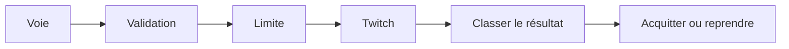

---
# Copyright (c) 2026 Adam Ousmer. All rights reserved.
# Proprietary. No license granted. See LICENSE.md.
title: Twitch outgress
description: "Exécute les actions API Twitch, l’envoi de messages, l’inscription EventSub et l’utilisation et le renouvellement des jetons."
docType: reference
---

## Responsabilités

Il consomme `twitch.outgress.{premium,standard,system}` et sert des RPC de gestion et de lecture. Les workers classent les erreurs pour les reprises, coordonnent les limites et refusent les effets issus des essais. Ingress gère les connexions Conduit ; Sesame prend les décisions.

## Interfaces

Les workers valident le message typé, choisissent les identifiants et l’action, obtiennent la capacité coordonnée et exécutent la requête Twitch. Les voies premium et standard portent les sorties ordinaires ; la voie système transporte les tâches de contrôle plus durables. Les erreurs sont classées pour les reprises et les lots ordonnés enregistrent leur progression. Une réponse externe ambiguë ne permet pas de supposer un effet unique.

## État et dépendances

Outgress utilise les identifiants stockés et la coordination partagée des limites ; Users gère les jetons et Ingress les sessions Conduit.

## Comportement en cas d’échec

Les workers classent les réponses pour les reprises. Un effet externe ambigu ne prouve pas une livraison unique.

## Code

Source : [app/twitch/outgress/](https://github.com/AdamOusmer/ItsBagelBot/tree/main/app/twitch/outgress). Voir `main.go`, `internal/worker/`, `internal/twitch/`, `rpc/` et `internal/domain/outgress/`.

## Validation

Depuis la racine, exécuter `go test ./app/twitch/outgress/... ./pkg/ratelimit/...`. La [page de validation](/fr/qa/outgress-hot-path-canary/) présente les invariants d’intégration.
