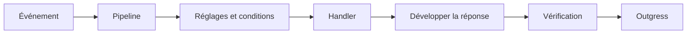

---
# Copyright (c) 2026 Adam Ousmer. All rights reserved.
# Proprietary. No license granted. See LICENSE.md.
title: Sesame
description: "Traite les événements Twitch, les modules intégrés et commandes personnalisées, la modération entrante, les minuteries et les réponses."
docType: reference
---

## Responsabilités

Ingress transmet les événements normalisés ; Sesame résout la configuration par projection et RPC, applique les conditions et publie des actions typées pour Outgress. Les événements d’essai sont traités sans sortie. L’application automatique d’AutoMod est désactivée par défaut ; les réponses sortantes complètes passent aussi une vérification.

## Interfaces

Ingress fournit les enveloppes normalisées ; Sesame publie les messages typés `internal/domain/outgress` sur la voie Twitch Outgress appropriée.

Le pipeline résout l’état de la chaîne, exécute les observateurs et la modération, distribue les commandes admissibles, développe les variables et publie les sorties décrites. Le registre `modules/all.go` définit les handlers disponibles ; chaque chaîne garde le contrôle de ses réglages. Un séquenceur borné traite les suites des événements de diffusion par chaîne ; en cas de débordement, le traitement en ligne ne conserve pas l’ordre FIFO. Les sorties issues des essais sont supprimées.

## État et dépendances

Les réglages et commandes proviennent des projections et RPC des propriétaires ; Sesame ne possède pas leurs schémas SQL.

## Comportement en cas d’échec

Les sorties d’essai sont supprimées. En cas de débordement du séquenceur, le traitement en ligne ne conserve pas l’ordre FIFO par chaîne.

## Code

Source : [app/twitch/sesame/](https://github.com/AdamOusmer/ItsBagelBot/tree/main/app/twitch/sesame). Voir `main.go`, `engine/pipeline.go`, `engine/dispatch.go`, `modules/all.go` et `automod/`.

## Validation

Depuis la racine, exécuter `go test ./app/twitch/sesame/...`. Voir `engine/pipeline.go`, `engine/moderate.go` et `internal/consumer/` pour le traitement et les reprises.
