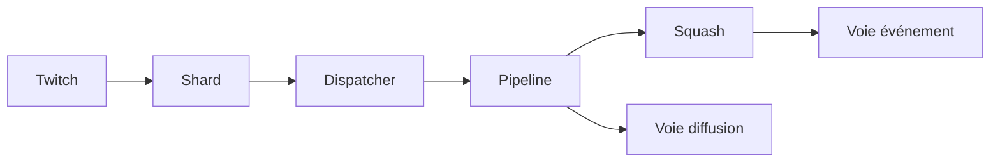

---
# Copyright (c) 2026 Adam Ousmer. All rights reserved.
# Proprietary. No license granted. See LICENSE.md.
title: Twitch ingress
description: "Reçoit les notifications Twitch EventSub au moyen d’un Conduit et de sessions WebSocket supervisées."
docType: reference
---

## Responsabilités

Ingress normalise et dirige les événements vers Sesame et les autres consommateurs. Il regroupe les messages ordinaires répétés en conservant les expéditeurs ; les commandes évitent ce regroupement. Les événements de diffusion utilisent aussi une voie dédiée. Sesame gère les comportements et Outgress les effets Twitch et les inscriptions.

## Interfaces

Les sujets d’événements historiques sont `twitch.ingress.event.{premium,standard,stream}`. La recherche du statut utilise par défaut `bagel.rpc.broadcaster.status.get` et les invalidations `bagel.cache.invalidate.status`.

Les sessions transmettent les notifications à un répartiteur borné. Le pipeline vérifie l’événement, choisit une voie et publie l’enveloppe partagée. L’admission d’une publication ne constitue pas un acquittement JetStream. Les événements de début et de fin de diffusion sont publiés sur la voie dédiée et sur la voie ordinaire, selon l’admissibilité de la chaîne. Le statut vient d’une RPC et non de la base d’un autre service.

## État et dépendances

Ingress gère le Conduit et les sessions de shards. Il obtient le statut des chaînes par RPC.

## Comportement en cas d’échec

L’admission locale à la publication est distincte de l’acquittement de stockage JetStream.

## Code

Source : [app/twitch/ingress/](https://github.com/AdamOusmer/ItsBagelBot/tree/main/app/twitch/ingress). Voir `lib/ingress/application.ex`, `pipeline.ex`, `shard_session.ex`, `squash.ex` et `nats/` ; l’enveloppe partagée est dans `internal/domain/event/lane/lane.go`.

## Validation

Depuis `app/twitch/ingress/`, exécuter `mix test`. Voir `lib/ingress/nats/publisher/` pour les réponses du courtier et `test/` pour les cas ciblés.
