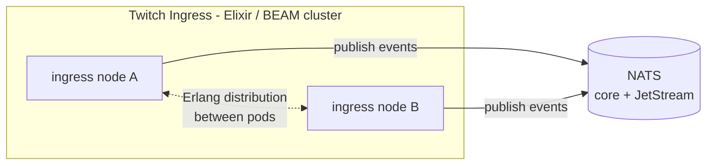
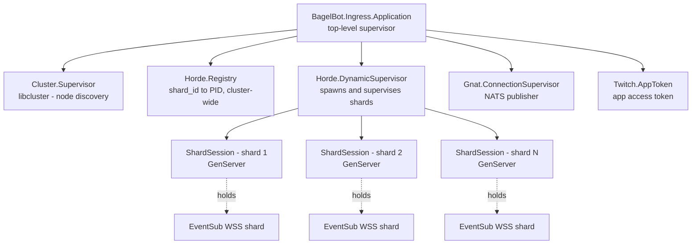

---
# Copyright (c) 2026 Adam Ousmer. All rights reserved.
# Proprietary. No license granted. See LICENSE.md.
title: Twitch Ingress
description: Service Elixir/BEAM qui possède le Conduit EventSub Twitch et ses shards WebSocket, filtre les payloads entrants et transmet les événements normalisés à NATS.
---

Twitch Ingress conserve les shards WebSocket d'un unique **EventSub Conduit** Twitch, les maintient après les resets, filtre les payloads entrants et publie les événements retenus sur NATS sous forme normalisée. C'est le seul service écrit en **Elixir sur la VM BEAM** ; le reste est en Go.

Le choix du langage est justifié dans [ADR 0006](/fr/adr/0006-adoption-of-elixir-for-twitch-ingress/). Le substrat de communication (NATS) derrière lequel il se trouve est justifié dans [ADR 0003](/fr/adr/0003-adoption-of-nats-as-communication-bridge/). Le matériel sur lequel il s'exécute est décrit dans [ADR 0004](/fr/adr/0004-adoption-of-oracle-cloud/).

## Responsabilités

- Maintenir un **EventSub Conduit Twitch** composé d'une petite flotte de shards WebSocket. Twitch répartit les événements entre les shards de son côté ; nous devons seulement les garder connectés.
- Maintenir le WebSocket de chaque shard : gérer la séquence `session_welcome` / `reconnect`, se reconnecter avec backoff après fermeture ou reset, et redémarrer isolément un shard défaillant.
- Conserver le **jeton d'accès de l'application** Twitch utilisé pour les appels Helix (gestion du Conduit et association des shards), et en obtenir un nouveau peu avant son expiration.
- **Filtrer** les payloads Twitch entrants et publier les survivants sur NATS comme événements normalisés. Les messages de chat ont exactement trois issues : ceux des identifiants utilisateur spéciaux (liste du secret store) vont toujours sur la **voie premium** ; ceux qui commencent par `!` vont sur la voie correspondant au statut du **broadcaster** (premium ou standard) ; le chat ordinaire publie sa première ligne immédiatement et regroupe les répétitions identiques en un seul événement qui liste leurs expéditeurs (squash). Les événements d'un broadcaster banni sont supprimés.
- Résoudre le statut du broadcaster par **requête-réponse NATS** auprès du service propriétaire de ces données (l'ingress ne lit jamais MySQL directement), derrière un cache read-through en processus évincé par des clés d'invalidation NATS.
- Répartir la propriété des shards entre les répliques ingress du cluster BEAM afin qu'un seul nœud possède le WSS de chaque shard, avec réaffectation en quelques secondes lorsqu'un nœud quitte le cluster.

Ce service ne traite pas les commandes (commandes de chat ou d'opérateur), ne fait pas de persistance, de logique métier ni de comptabilisation de limites de débit. Tout ce qui doit réagir aux événements vit dans les services Go en aval et s'abonne aux sujets NATS publiés par ce service.

## Forme externe

Les nœuds ingress forment un seul cluster BEAM via la distribution Erlang. Aucun port public n'est exposé. Les seuls éléments qui quittent le cluster sont les messages NATS publiés.

## Forme interne (arbre de supervision OTP)

- **`BagelBot.Ingress.Application`** est le superviseur de premier niveau. Stratégie de redémarrage : `:one_for_one`.
- **`Cluster.Supervisor` (libcluster)** découvre les nœuds pairs et appelle `Node.connect/1` sur ceux-ci. La stratégie suit l'environnement : DNS Kubernetes lorsque `BAGELBOT_K8S_HEADLESS_SERVICE` est défini, EPMD avec `BAGELBOT_CLUSTER_HOSTS`, sinon Gossip.
- **`Horde.Registry`** est un registre distribué à l'échelle du cluster, fondé sur un CRDT. Chaque shard est enregistré sous une clé telle que `{:shard, shard_id}`. La recherche inter-nœuds est un appel `Horde.Registry.lookup/2`.
- **`Horde.DynamicSupervisor`** crée les shards et les réattribue aux nœuds survivants lorsqu'un nœud tombe.
- **`ShardSession`** est un `GenServer` par shard. Il possède un WebSocket, pilote la machine d'état du protocole EventSub, exécute le filtre sur chaque payload entrant et publie les survivants sur NATS.
- **`Gnat.ConnectionSupervisor`** possède les connexions NATS (Gnat est le client NATS Elixir). Le bus d'événements et le plan RPC utilisent des connexions et des identités distinctes.
- **`Twitch.AppToken`** est un processus unique qui conserve le jeton d'accès de l'application. Il en obtient un nouveau lorsque le jeton en cache expire dans moins d'une minute.

Le filtre lui-même est un module de fonction pure (sans état ni enfant du superviseur). Chaque `ShardSession` l'appelle en ligne avant de décider de publier.

### Stratégies de redémarrage

| Processus                       | Stratégie       | Notes                                                                                |
|---------------------------------|-----------------|--------------------------------------------------------------------------------------|
| `Application`                   | `:one_for_one`  | La panne d'un sous-système ne fait pas tomber ses frères.                           |
| `Horde.DynamicSupervisor`       | `:one_for_one`  | Le crash d'un shard ne redémarre que ce shard.                                       |
| `ShardSession`                  | `:transient`    | Un arrêt normal (shard supprimé) ne redémarre pas ; un crash redémarre avec backoff. |
| `Twitch.AppToken`               | `:permanent`    | Toujours redémarré ; sans le jeton d'application, aucun shard ne peut s'associer.   |
| `Gnat.ConnectionSupervisor`     | `:permanent`    | Toujours redémarré ; sans NATS, l'ingress est inutilisable.                          |

Le backoff de reconnexion d'un shard est exponentiel, avec jitter, et plafonné à 60 secondes.

## Partitionnement et propriété

Twitch gère de son côté le routage des événements entre les shards du Conduit ; nous ne choisissons pas la destination de chaque chaîne. Nous possédons le maintien de chaque WebSocket et la réattribution de cette propriété entre les nœuds BEAM lorsque le cluster change.

Le déroulement est le suivant :

1. Au démarrage, le cluster lit le nombre de shards du Conduit et garantit qu'un `ShardSession` existe pour chaque shard, démarré via `Horde.DynamicSupervisor.start_child` et enregistré dans `Horde.Registry` sous `{:shard, shard_id}`.
2. Lorsqu'un nœud quitte le cluster, `Horde` réattribue ses shards aux nœuds survivants. Le nouveau propriétaire rouvre le WebSocket et le réenregistre auprès de Twitch via l'API EventSub.
3. Lorsqu'un nœud rejoint le cluster, `Horde` lui migre des shards selon `Ingress.ShardDistribution` : round-robin par identifiant de shard entre les nœuds vivants (triés par nom), si bien que cinq shards sur deux nœuds se répartissent toujours en 3/2. Le placement est déterministe ; la redistribution active ne déplace que les shards dont la cible a réellement changé.

Nous n'utilisons délibérément pas NATS KV pour cela. Le registre du cluster BEAM fait autorité, vit en mémoire et se met à jour de façon synchrone entre les nœuds. Voir [ADR 0006](/fr/adr/0006-adoption-of-elixir-for-twitch-ingress/) pour le raisonnement.

## Contrats NATS

L'ingress publie les événements et l'état, émet des appels requête-réponse pour le statut du broadcaster et s'abonne aux clés d'invalidation du cache, à `data.users.changed` (éviction des essais) et à ses propres sujets RPC d'administration.

Préfixes des sujets :

- **`twitch.ingress.event.<lane>`** : événements sortants normalisés publiés après filtrage. Exactement trois sujets : `premium` / `standard` (répartis selon le statut du broadcaster) et `stream` (uniquement les événements stream online/offline) ; le `type` EventSub voyage dans le payload, pas dans le sujet.
- **`twitch.ingress.status.*`** : signaux sortants de cycle de vie et de santé.
- **`bagel.rpc.broadcaster.status.get`** : requête-réponse pour consulter le statut auprès du service Go propriétaire.
- **`bagel.cache.invalidate.status`** : entrée qui évince les entrées du cache de statut en processus.
- **`twitch.ingress.admin.shards.get`** : requête-réponse entrante traitée par `Ingress.AdminRpc`, qui fournit à la console [Admin](/fr/microservices/admin/) un instantané d'état des shards du cluster. Un groupe de files garantit qu'une seule réplique répond ; la réponse couvre chaque shard via le registre Horde.
- **`twitch.ingress.admin.shards.scale`**, **`.shards.autoscale`** et **`twitch.ingress.admin.trials.*`** (`list`, `add`, `remove`, `set_enabled`) : requête-réponse entrante pour la mise à l'échelle des shards et les chaînes d'essai.
- **`bagel.rpc.ingress.conduit.get`** : requête-réponse entrante renvoyant l'identifiant du Conduit actif (utilisé par Twitch Outgress). La santé est servie sur `bagel.rpc.health.ingress`.

### Sortie : événements

| Sujet                                        | Payload (JSON)                                                                                | Notes                                |
|----------------------------------------------|-----------------------------------------------------------------------------------------------|--------------------------------------|
| `twitch.ingress.event.premium`               | chat: enveloppe aplatie (`type`, `lane`, identité du broadcaster et du chatteur, `text`, `msg_id`, horodatage) ; non-chat: payload EventSub tel que livré par Twitch, plus `{type, lane, received_at, shard_id, msg_id}` | Broadcasters premium et identifiants spéciaux. |
| `twitch.ingress.event.standard`              | mêmes formes que premium                                                                       | Broadcasters standard et événements sans broadcaster extractible. |
| `twitch.ingress.event.stream`                | payload EventSub plus `{type, lane, received_at, shard_id, msg_id}`                           | `stream.online` / `stream.offline` uniquement, quel que soit le statut du broadcaster. Chacun est aussi publié sur le sujet premium ou standard du broadcaster. |

Les notifications de chat et tous les autres types EventSub abonnés circulent sur les sujets premium/standard ; les consommateurs distribuent selon le champ `type` du payload. Les payloads contiennent `msg_id` afin que les consommateurs dédupliquent les rediffusions Twitch.

### Sortie : état

| Sujet                                        | Payload                                                                                       |
|----------------------------------------------|-----------------------------------------------------------------------------------------------|
| `twitch.ingress.status.shard.up`             | `{shard_id, node, session_id, since}`                                                             |
| `twitch.ingress.status.shard.bound`          | `{shard_id, node, session_id, kind, at}` ; `kind` vaut `fresh` (connexion complète + association Helix) ou `moved` (handshake `session_reconnect` terminé) |
| `twitch.ingress.status.shard.down`           | `{shard_id, node, reason}` ; `reason` contient `reconnecting` et `duplicate_resolved` (un doublon issu de la guérison d'un netsplit s'arrête) |
| `twitch.ingress.status.authz.granted` / `authz.revoked` | `{user_id, user_login, at}`, à partir des événements Twitch `user.authorization`        |
| `twitch.ingress.status.authz.subrevoked`     | `{broadcaster_id, type, status, at}`, lorsque Twitch révoque un abonnement                    |

Les sujets d'état partagent le flux JetStream `TWITCH_INGRESS` avec les voies premium et stream, qui conserve les messages 10 secondes.

## Configuration

Pilotée par l'environnement. Toutes les valeurs arrivent comme variables d'environnement et sont lues une fois au démarrage.

| Variable                       | Rôle                                                                     | Exemple                                     |
|--------------------------------|--------------------------------------------------------------------------|---------------------------------------------|
| `RELEASE_NODE`                 | Nom long Erlang de ce nœud (le manifeste définit `ingress@$(POD_IP)`).   | `ingress@10.42.0.7`                         |
| `RELEASE_COOKIE`               | Cookie partagé pour la distribution. Le manifeste le lit dans la clé de secret `BAGELBOT_ERLANG_COOKIE`. | (opaque)           |
| `BAGELBOT_K8S_HEADLESS_SERVICE` | Service headless pour la découverte DNS Kubernetes ; prioritaire sur `BAGELBOT_CLUSTER_HOSTS`. | (non défini)             |
| `BAGELBOT_CLUSTER_HOSTS`       | Noms longs des pairs séparés par des virgules pour la stratégie EPMD de libcluster. | `ingress-a@10.42.0.7,ingress-b@10.42.0.8` |
| `NATS_HOST` / `NATS_PORT`      | Point d'accès NATS (port par défaut `4222`).                             | `127.0.0.1`                                 |
| `NATS_JWT` / `NATS_NKEY_SEED`  | Identifiants du bus. `NATS_RPC_JWT` / `NATS_RPC_NKEY_SEED` configurent la connexion RPC distincte. | (opaque)                 |
| `TWITCH_CLIENT_ID`             | Identifiant client pour les appels à l'API Twitch.                      | (opaque)                                    |
| `TWITCH_CLIENT_SECRET`         | Secret client de l'application.                                         | (opaque)                                    |
| `TWITCH_CONDUIT_ID`            | Conduit possédé par cet ingress.                                        | `conduit_abc123`                            |
| `TWITCH_CONDUIT_SHARD_COUNT`   | Nombre souhaité de shards dans le Conduit (`2` par défaut ; `TWITCH_CONDUIT_MAX_SHARDS` plafonne la mise à l'échelle, `11` par défaut). | `4`                  |
| `TWITCH_EVENTSUB_WSS_URL`      | Endpoint WebSocket EventSub Twitch, fixé par la configuration.           | `wss://eventsub.wss.twitch.tv/ws`           |
| `TWITCH_SPECIAL_USER_IDS`      | Identifiants de chat toujours envoyés sur la voie premium, depuis le secret store. | `1001,1002` |
| `NATS_SUBJECT_LANE_PREMIUM`    | Sujet de la voie premium (tous les types d'événements).                  | `twitch.ingress.event.premium`              |
| `NATS_SUBJECT_LANE_STANDARD`   | Sujet de la voie standard (tous les types d'événements).                 | `twitch.ingress.event.standard`             |
| `NATS_SUBJECT_LANE_STREAM`     | Voie dédiée aux seuls événements stream.online / stream.offline.         | `twitch.ingress.event.stream`               |
| `NEW_RELIC_LICENSE_KEY`        | Active la surveillance New Relic ; sans clé, l'agent ne fait rien.       | (opaque)                                    |
| `NEW_RELIC_APP_NAME`           | Nom de l'application New Relic.                                         | `itsbagelbot-twitch-ingress`                |
| `NATS_BROADCASTER_STATUS_SUBJECT` | Sujet requête-réponse des consultations de statut broadcaster.        | `bagel.rpc.broadcaster.status.get`          |
| `NATS_CACHE_INVALIDATION_SUBJECT` | Sujet contenant les clés d'invalidation du cache broadcaster.         | `bagel.cache.invalidate.status`             |
| `NATS_ADMIN_SUBJECT`           | Sujet requête-réponse fournissant l'instantané d'état des shards.        | `twitch.ingress.admin.shards.get`           |
| `BROADCASTER_CACHE_TTL_SECONDS`| TTL du cache de statut broadcaster en processus.                         | `300`                                       |
| `LOG_LEVEL`                    | `debug` / `info` / `warn` / `error`.                                     | `info`                                      |

## Déploiement

- **Réplicas :** 3, répartis un par hôte (`topologySpreadConstraints` sur `kubernetes.io/hostname`) et tenus à l'écart des nœuds de rôle plan de contrôle et worker (`deploy/k8s/twitch-ingress.yaml`).
- **Runtime :** Elixir 1.17+ (`mix.exs`), construit avec Elixir 1.20 sur OTP 28. Publié comme release Mix (`mix release`) sur une image de base `debian:trixie-slim`.
- **Modèle de processus :** un conteneur par nœud. BEAM est le runtime de concurrence ; nous n'exécutons pas plusieurs VM BEAM par pod.
- **Réseau :** la distribution Erlang reste interne au cluster. Aucun port public ; NATS est joint par le réseau du cluster.
- **Contrôles de santé :** les sondes de vivacité et de disponibilité de Kubernetes exécutent `/app/bin/ingress pid`. Un écouteur HTTP distinct (`STATUS_PORT`, `8080` par défaut) sert `/healthz`, `/readyz` et `/status`.
- **Mises à jour progressives :** un nœud à la fois. `SIGTERM` déclenche `:init.stop/0`, qui exécute les callbacks d'arrêt de l'application et laisse Horde vider les shards vers les nœuds survivants avant la sortie.

## Observabilité

- **Journaux :** `Logger` vers stdout avec les métadonnées `shard_id` et `node` ; `LOG_LEVEL` fixe le niveau.
- **Métriques :** des compteurs en processus sont envoyés chaque seconde à New Relic sous forme de métriques `Custom/Ingress/*`, et les événements notables des shards sont signalés comme événements personnalisés `IngressEvent`. Sans `NEW_RELIC_LICENSE_KEY`, l'agent ne fait rien.
- **Traces :** une part échantillonnée des notifications (`INGRESS_TRACE_SAMPLE_RATE`) s'exécute comme transaction New Relic `Ingress`, avec l'attente dans la file du dispatcher enregistrée comme attribut.

## Modes de panne et réponses du service

| Panne                                              | Réponse                                                                                                       |
|----------------------------------------------------|---------------------------------------------------------------------------------------------------------------|
| Le WebSocket d'un shard tombe                      | `ShardSession` intercepte la fermeture, redémarre via le superviseur et se reconnecte avec backoff. Les shards frères restent intacts. |
| Twitch renvoie 401 pour un shard                   | L'appel Helix abandonne le jeton d'application en cache (`Twitch.AppToken`) ; la tentative suivante en obtient un nouveau. Si l'appel échoue durablement, le shard crashe et le superviseur le redémarre. |
| Un nœud ingress tombe                               | `Horde` réattribue ses shards aux nœuds survivants. Les nouveaux propriétaires rouvrent les WebSockets et les réenregistrent auprès de Twitch ; des événements d'état sont émis. |
| NATS est inaccessible                              | `Gnat.ConnectionSupervisor` se reconnecte. Les événements sortants sont bufferisés (avec limite) puis supprimés en cas de débordement avec un journal de niveau avertissement ; nous préférons la perte à une croissance mémoire illimitée. |
| Partition de la distribution Erlang                | Chaque côté devient un cluster sans quorum et peut exécuter des shards en double. Après rétablissement, la fusion du registre signale le doublon et la résolution est fondée sur la santé : la copie **liée** au Conduit conserve le shard (en reprenant l'enregistrement si le registre avait choisi la copie non liée), tandis que la copie redondante s'arrête correctement et publie `shard.down` avec la raison `duplicate_resolved`. |
| Un seul payload Twitch mal formé                   | Le shard crashe, le superviseur le redémarre et Twitch renvoie l'événement via le Conduit. Aucun raz-de-marée de retries sur les payloads invalides. |

## Références

- [ADR 0001](/fr/adr/0001-rewriting-to-microservices/) : la réécriture en microservices, qui a initialement fait apparaître le problème des sockets Twitch zombies que ce service résout.
- [ADR 0003](/fr/adr/0003-adoption-of-nats-as-communication-bridge/) : NATS comme substrat de communication et espace de sujets publié par ce service.
- [ADR 0004](/fr/adr/0004-adoption-of-oracle-cloud/) : la flotte où s'exécute ce service.
- [ADR 0006](/fr/adr/0006-adoption-of-elixir-for-twitch-ingress/) : le choix du langage et du runtime de ce service.
