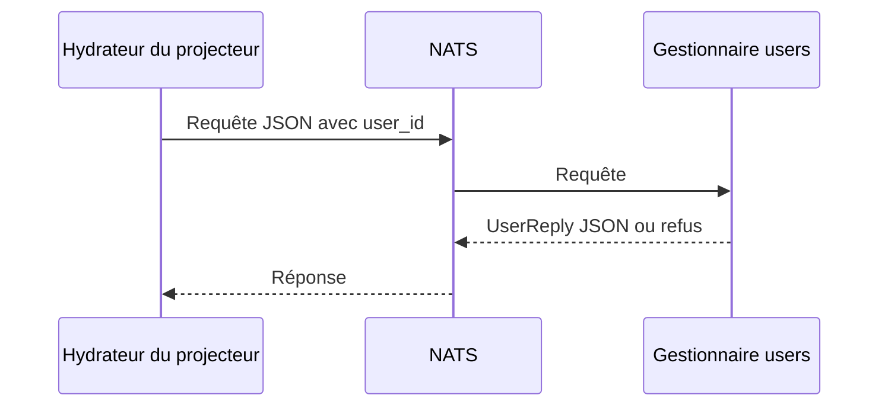

---
# Copyright (c) 2026 Adam Ousmer. All rights reserved.
# Proprietary. No license granted. See LICENSE.md.
title: Contrats RPC
description: "Trouver et modifier les contrats NATS request-reply."
docType: reference
---

Les services utilisent NATS request-reply pour franchir les limites de propriété. Les types de contrat sont sous `internal/domain/rpc/`; les gestionnaires et la configuration des sujets sont dans le service propriétaire sous `app/`. Cette page montre comment suivre un contrat; elle ne liste pas tous les endpoints.

## Exemple : instantané utilisateur pour la projection

Le service users utilise par défaut `bagel.rpc.internal.projection.users.get` (`app/db/users/main.go`). La variable `NATS_INTERNAL_PROJECTION_USERS_SUBJECT` peut remplacer ce sujet. `internal/domain/rpc/projection/projection.go` définit la requête et la réponse JSON. La requête contient un identifiant utilisateur sous forme de chaîne :

```json
{"user_id":"12345"}
```

`UserReply` contient `user_id`, `status`, `is_active`, `banned` et des champs facultatifs comme `locale`, ainsi qu'un refus intégré. Consultez le type pour la forme complète. L'hydrateur du projecteur appelle les endpoints d'instantanés users, modules et commands (`app/projector/hydration/hydrator.go`).



## Erreurs et délais

Un transport réussi ne signifie pas que l'opération a réussi. Beaucoup de réponses intègrent `rpc.Refusal`, avec `error` et `code` facultatifs. `internal/domain/rpc/code.go` définit `invalid`, `not_found`, `forbidden`, `conflict`, `unavailable` et `internal`; les contrats individuels peuvent varier. Un délai dépassé ou une panne de connexion peut empêcher toute réponse. Les appelants fixent des délais et les gestionnaires peuvent en imposer d'autres; examinez les deux côtés. Ne supposez pas une représentation unique des identifiants ou des erreurs.

## Suivre une modification

1. Trouvez le DTO et ses balises JSON dans `internal/domain/rpc/<domain>/`.
2. Trouvez le gestionnaire, son sujet, sa variable d'environnement et son groupe dans le service propriétaire sous `app/`.
3. Trouvez les appelants, leurs délais, leurs erreurs et leurs hypothèses d'autorisation. Les appelants web sont aussi sous `web/`.
4. Vérifiez les permissions des sujets dans `deploy/messaging/accounts.yaml` et les tests du format et du comportement.

`pkg/bus/rpc.go` et `pkg/bus/rpcwiring.go` fournissent les mécanismes partagés. Les événements ont un contrat distinct : voir `internal/domain/event/` et `pkg/bus/streams.go` pour leurs données et leur rétention.

## Exemple : compte absent

Le [gestionnaire de projection users](https://github.com/AdamOusmer/ItsBagelBot/blob/main/app/db/users/rpc/projection.go) valide la requête avec `ServeForUser` puis consulte le dépôt. Un résultat Ent not-found devient un `UserReply` avec `code: "not_found"` et un message; les autres erreurs passent par le mécanisme RPC partagé. Le client doit distinguer ce refus applicatif de l'absence de réponse due au transport ou à un délai. Pour une mutation, une nouvelle tentative après un délai est particulièrement importante : le serveur peut avoir terminé l'opération sans que l'appelant ait reçu la réponse.

Pour modifier ce contrat, comparez le [DTO](https://github.com/AdamOusmer/ItsBagelBot/blob/main/internal/domain/rpc/projection/projection.go), le [gestionnaire propriétaire](https://github.com/AdamOusmer/ItsBagelBot/blob/main/app/db/users/rpc/projection.go) et l'[appelant de l'hydrateur](https://github.com/AdamOusmer/ItsBagelBot/blob/main/app/projector/hydration/hydrator.go). Testez les identifiants invalides, l'absence de compte, une réponse réussie et les délais ou dépendances indisponibles selon le cas. Préservez les balises JSON et les permissions des sujets lors d'ajouts compatibles.
