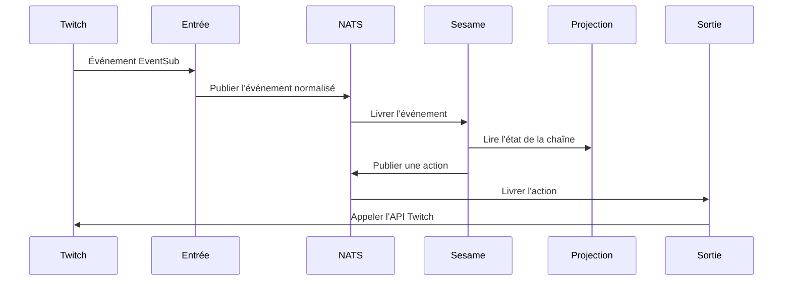

---
# Copyright (c) 2026 Adam Ousmer. All rights reserved.
# Proprietary. No license granted. See LICENSE.md.
title: État du système
description: "Emplacement des services et parcours d’un événement vers une réponse."
docType: reference
---

## Carte des services

Le dépôt sépare les entrées et sorties des plateformes, les décisions du bot, la propriété des données et les interfaces web. Les services communiquent par NATS; les flux et leurs limites de rétention sont définis dans `pkg/bus/streams.go`.

| Domaine | Code | Responsabilité |
| --- | --- | --- |
| Entrée Twitch | `app/twitch/ingress/` | Recevoir et normaliser les événements Twitch |
| Sesame | `app/twitch/sesame/` | Évaluer les modules, commandes et autres comportements |
| Sortie Twitch | `app/twitch/outgress/` | Exécuter les actions Twitch |
| Services de données | `app/db/` | Posséder les données et exposer les opérations |
| Projecteur | `app/projector/`, `internal/projection/` | Maintenir et servir l'état dérivé |
| Discord | `app/discord/` | Entrée, décisions et sortie Discord |
| API externes | `app/gossip/` | Intégrations des fournisseurs |
| Web | `web/dashboard/`, `web/admin/`, `web/marketing/`, `web/docs/` | Tableau de bord, administration, marketing et documentation |

## Parcours courant d’un événement

Ce parcours illustre un cas courant, pas tous les événements ni tous les replis. L'entrée utilise des voies premium et standard; Sesame transmet la priorité à la sortie. Le code et la configuration définissent les délais, les tentatives et la rétention de chaque voie. Un consommateur durable ne garantit ni une rétention infinie ni un traitement exactement une fois.

Voir [Données et état](/fr/data-and-state/) pour la propriété et l'hydratation. Les types RPC sont sous `internal/domain/rpc/`; [Contrats RPC](/fr/reference/rpc-contracts/) donne une carte initiale. `CONTEXT-MAP.md` décrit les limites et les emplacements réservés. Les manifestes sont sous `deploy/` et peuvent évoluer indépendamment de ces limites.
