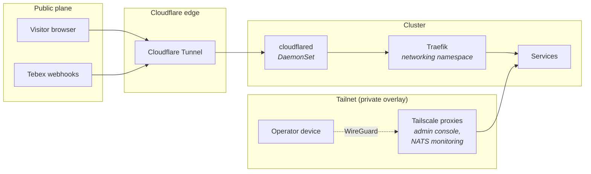

---
# Copyright (c) 2026 Adam Ousmer. All rights reserved.
# Proprietary. No license granted. See LICENSE.md.
title: Networking
description: Cloudflare Tunnel ingress, Tailscale private access, Cilium, and the default-deny posture that ties the cluster together.
---

Public traffic reaches the cluster only through an outbound Cloudflare Tunnel. Operator access goes through Tailscale. Inside the cluster, every namespace starts from a default-deny network policy and opens only the paths it needs. No connection gets trust from its network position alone.

The hosting and tailnet decision is recorded in [ADR 0004](/adr/0004-adoption-of-oracle-cloud/); this page is the operational reference.

## The two planes

- **Public plane (Cloudflare):** anything that must be reached by a party we do not control, such as broadcasters opening the dashboard and Tebex posting purchase webhooks. Twitch events do not arrive here: ingress opens outbound EventSub WebSocket connections.
- **Private plane (Tailscale):** operator access to the admin console, NATS monitoring, and the Kubernetes API.

## Cloudflare Tunnel: the public ingress

`cloudflared` runs as a DaemonSet on every node except the control plane (`deploy/operators/cloudflared.yaml`). Every ingress rule forwards to the Traefik Service in the `networking` namespace over TLS. The connector trusts only the Cloudflare Origin CA, and it forces the SNI to the zone apex so routing never depends on which public hostnames exist.

### What is exposed

| Hostname | Purpose |
| --- | --- |
| `dashboard.itsbagelbot.com` | The broadcaster console (SvelteKit). The app's `/status`, `/healthz` and `/readyz` are masked at Traefik. |
| `stats.itsbagelbot.com` | The public stats page. |
| `commands.itsbagelbot.com`, `leaderboard.itsbagelbot.com` | Public commands pages and leaderboards, served by the dashboard app through the wildcard rule. |
| `health.itsbagelbot.com` | Per-service `/status` endpoints read by the hosted status page (`deploy/k8s/status-routes.yaml`). |
| `webhooks.itsbagelbot.com` | Tebex webhooks to the transactions service. |
| `itsbagelbot.com` and `*.itsbagelbot.com` | Everything else on the zone. Traefik owns the routing decision, and unrouted hosts fall back to the marketing site. |

`status.itsbagelbot.com` is the hosted status page itself. Its DNS points at the status provider, so the tunnel does not claim it.

The tunnel configuration ends with a required `http_status:404` rule.

### Why a tunnel

A tunnel keeps the nodes off the public internet and gives edge TLS termination and DDoS absorption for the public webhook receiver. Tebex gets a stable, branded webhook URL instead of a node address.

## Tailscale: the private overlay

The Tailscale Kubernetes operator publishes selected Services to the tailnet through Ingress resources with `ingressClassName: tailscale`:

| Service | Where defined |
| --- | --- |
| Admin console | `deploy/k8s/console-admin.yaml` |
| NATS monitoring | `deploy/messaging/nats.yaml` |
| Traefik dashboard and the Falco UI | Allowed by `deploy/networking/network-policies.yaml` and `deploy/observability/network-policies.yaml` |

The admin console therefore has no public hostname. Operators reach it only from a device on the tailnet.

The Cilium configuration points the Kubernetes API server address at a tailnet address (`deploy/cilium/values.yaml`). The tailnet policy itself is not stored in this repository.

## Inside the cluster

- **CNI:** Cilium in native routing mode with kube-proxy replacement, BBR bandwidth management, and BIG TCP (`deploy/cilium/values.yaml`).
- **Network policies:** each namespace carries a default-deny policy plus explicit allows (`deploy/*/network-policies.yaml`, `deploy/k8s/network-policies.yaml`). Cross-namespace paths name the source namespace and pod labels.
- **Service-to-service transport:** NATS carries all inter-service traffic ([ADR 0003](/adr/0003-adoption-of-nats-as-communication-bridge/)). Valkey and NATS use TLS with certificates issued through cert-manager (`deploy/cache/certificates.yaml`, `deploy/messaging/certificates.yaml`). The MySQL connection pins the HeatWave CA through `DB_CA_CERT`. Traefik re-encrypts to the dashboard console, so that hop is TLS end to end.
- **Secrets:** the Doppler operator syncs secrets into the namespaces that need them (`DopplerSecret` resources next to each workload).

## What is deliberately not here

- **A LAN ingress.** No `NodePort` or `LoadBalancer` Services exist in `deploy/`.
- **A VPN concentrator on the cluster.** Tailscale is the VPN; we do not run a second one.

## Where to next

- **[Hardware & cluster →](/infrastructure/hardware-and-cluster/)**: what the nodes are and how K3s is shaped.
- **[ADR 0004 →](/adr/0004-adoption-of-oracle-cloud/)**: the hosting and tailnet decision.
