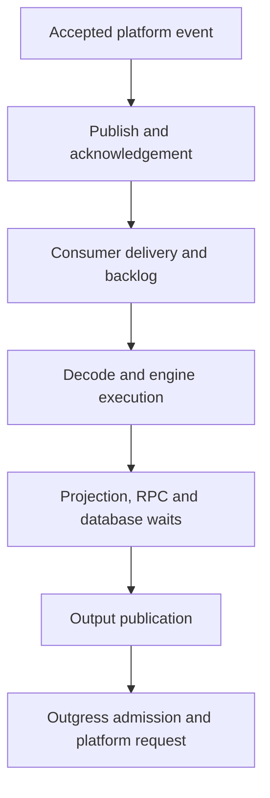

---
# Copyright (c) 2026 Adam Ousmer. All rights reserved.
# Proprietary. No license granted. See LICENSE.md.
title: Investigate latency
description: Follow a request through the code and distinguish waiting from execution.
docType: how-to
---

A slow reply can spend its time waiting for work, waiting for a dependency, or executing. Find the boundary first. Adding more spans inside the engine will not explain a queue that is already backed up.

## Prerequisites and outcome

Choose a slow operation, a time window and the affected service or lane. Access to the relevant logs and measurements is needed; distributed traces require monitoring to be configured. Without a license the application can still run, but do not expect a New Relic trace. Record the symptom and a baseline before changing instrumentation.

## 1. Check available instrumentation

Check whether the service has monitoring configured, then inspect its logs and available traces for the chosen operation. Go services start monitoring through `pkg/svcboot`. `pkg/monitor.New` returns no application when `NEW_RELIC_LICENSE_KEY` is absent, so local execution and tests do not require an observability account.

`pkg/monitor` attaches entity metadata to logs and trace/span IDs when a transaction exists. It disables agent log forwarding, excludes request/response attributes and HTTP URLs, and disables datastore raw query and parameter capture. `ScrubError` keeps a bounded error prefix and type. These controls reduce captured data; they are not a reason to put tokens or message bodies into log fields.

`pkg/bus/telemetry.go` carries tracing across bus boundaries. Preserve the handler context when calling dependencies so the next segment can belong to the same request.

## 2. Locate the slow boundary

Follow the event through the following boundaries and identify where elapsed time or backlog first grows.

| Symptom | Start in the code |
| --- | --- |
| Input is accepted but work arrives late | Ingress dispatcher, bus publisher, consumer backlog |
| Cold requests are slower | `internal/projection`, Projector hydration and owner RPC |
| Database work waits before a query | `pkg/db/gate.go`, pool settings and `pkg/db/stats.go` |
| Output keeps returning for another attempt | `pkg/bus` delivery handling and Outgress limiter decisions |
| HTTP effect is slow | Outgress or Gossip transport, upstream status and response handling |

Pool wait, process gate wait and query duration are different measurements. A cache miss is not automatically an error. A delivery acknowledgement is not proof that Twitch displayed a message.

Use bounded operation names, subjects and outcome classes. Broadcaster IDs, message bodies, tokens, arbitrary URLs and cache keys do not belong in metric names.

## 3. Verify and compare

Run the focused tests for the boundary you changed. `pkg/bus/telemetry_test.go` covers trace transport, and `pkg/monitor/scrub_test.go` covers scrubbing. Keep the no-license path working. If you claim a latency improvement, attach the workload and commit that produced it; a new span alone proves no improvement.

See [performance work](/infrastructure/performance/) and [testing](/guides/testing/).

Source: [monitor](https://github.com/AdamOusmer/ItsBagelBot/tree/main/pkg/monitor), [bus telemetry](https://github.com/AdamOusmer/ItsBagelBot/blob/main/pkg/bus/telemetry.go), [database pool metrics](https://github.com/AdamOusmer/ItsBagelBot/blob/main/pkg/db/stats.go).

## Troubleshoot and report

If a trace is missing, check whether monitoring is enabled and whether the handler passes its context across the bus and dependency calls. Use logs and boundary measurements when no trace is available; do not infer a queue delay from total latency alone. Compare the same operation and window before and after a change, and report the commit, workload, sample size, errors and latency distribution. State which boundaries were measured and which remain unknown. Continue with [Measure performance](/infrastructure/performance/) when a reproducible workload is available.
