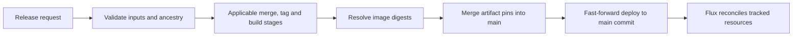

---
# Copyright (c) 2026 Adam Ousmer. All rights reserved.
# Proprietary. No license granted. See LICENSE.md.
title: Release code
description: How the release train turns a main commit into pinned deployable artifacts.
docType: explanation
---

Release behavior lives in code too. `app/release` is a Go CLI, and `.github/workflows/release.yml` runs its stages in separate jobs. The admin console can start the workflow; it does not become a second release implementation.

## Inputs and state

The CLI accepts `release`, `hotfix`, `bump`, `rollback` and `reapply`. Its flags include the version, target main SHA, PRs to merge, selected services and a changelog JSON path. `-stage` runs a single stage. `-state` selects the persisted run file; an existing file is resumed instead of seeded again.

`internal/domain/rpc/deploy` defines the shared run contract. `app/release/internal/train` drives the run. Ports isolate GitHub, registry and clock behavior from orchestration, so the train and stage tests can use fakes.



The exact stage selection depends on the run kind. Read `app/release/internal/stages/github` and the workflow before changing that selection.

## The branch contract

`main` owns artifact pin changes. `deploy` points to a main commit and advances by fast-forward. It does not receive a separate promotion commit. Rollback makes a new pin change on main and promotes that commit; it does not rewind deploy history. Reapply must also satisfy the ancestry checks.

That contract lets the deployed state be traced back to reviewed source and pins. A direct edit to the deploy branch breaks the release model even if the files look right.

## Work on the train

Start with `app/release/main.go`, the train tests and the stage tests. Use fakes while changing orchestration. A real CLI run can merge PRs, tag, publish images and move a branch, so it is not a local smoke test.

```sh
go test ./app/release/...
```

Deployment topology and provider credentials are separate from the release state machine. This page documents the code contract rather than a particular cluster layout.

Source: [release CLI](https://github.com/AdamOusmer/ItsBagelBot/tree/main/app/release), [workflow](https://github.com/AdamOusmer/ItsBagelBot/blob/main/.github/workflows/release.yml).

## Failure, recovery and validation

The [train](https://github.com/AdamOusmer/ItsBagelBot/blob/main/app/release/internal/train/train.go) records each attempt as running, succeeded, skipped or failed. An error marks the stage and run failed; the driver stops. On a resumed run, succeeded and skipped stages are not due again. Before running a stage, its `Done` check can recognize work already completed. A state file records orchestration progress; inspect the external GitHub and registry state as well before retrying an interrupted operation.

`go test ./app/release/...` exercises the train and stage tests without making a real release. The [workflow](https://github.com/AdamOusmer/ItsBagelBot/blob/main/.github/workflows/release.yml) and stage implementations remain authoritative for which steps run for each request. A completed promotion advances Git state; reconciliation by Flux is a separate outcome and should be verified separately.
