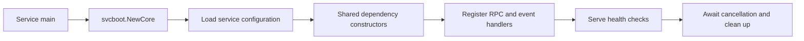

---
# Copyright (c) 2026 Adam Ousmer. All rights reserved.
# Proprietary. No license granted. See LICENSE.md.
title: Runtime configuration
description: How services start, load configuration, connect to dependencies, and report health.
docType: reference
---

The deployment supplies addresses and credentials. The code decides how they are used. Start with the service entry point and its config loader before copying an environment variable from another service.

For host NIC settings, queue counts, interrupt affinity, offloads and persistence on node1–3, see [worker network tuning](/infrastructure/node-network-tuning/).

## Go service lifecycle

`pkg/svcboot` owns logging, monitoring, signal cancellation and shared dependency constructors. `NewCore` returns the service context and cleanup function. Database services use `pkg/svcboot/databoot` for their Ent driver. The guard in `pkg/svcboot/guard_test.go` checks that service entry points use this boundary.

The Elixir applications have their own supervision trees. Read `app/twitch/ingress/lib/ingress/application.ex` and `app/controls/gateway/lib` for those paths.

## Shared defaults

`pkg/svcboot/infra.go` loads these defaults. A service can add or override configuration in its own loader.

| Variable | Default | Meaning |
| --- | --- | --- |
| `NATS_URL` | `nats://127.0.0.1:4222` | Main bus connection address |
| `NATS_RPC_URL` | `NATS_URL` | RPC connection address |
| `VALKEY_ADDR` | `127.0.0.1:6379` | Valkey address |
| `VALKEY_PASSWORD` | Empty | Valkey authentication input |
| `LISTEN_ADDR` | `:8080` | Service HTTP listener |

These are loader defaults, not a complete local environment. They do not provision streams, schemas, accounts, platform grants or secrets.

`pkg/env` treats empty values as absent. Typed getters fall back when parsing fails; `MustGet` panics when a required value is missing. Check which helper the service uses before relying on startup to reject a typo.

## Connections and credentials

`pkg/bus/connect.go` separates RPC credentials from general bus credentials. `NATS_RPC_JWT` and `NATS_RPC_NKEY_SEED` fall back to `NATS_JWT` and `NATS_NKEY_SEED`. TLS setup reads `NATS_CA_PEM` and the client certificate/key inputs through `pkg/tlsenv`. Publisher routing can also use hub-specific addresses. An RPC leaf address is not automatically the right JetStream publisher address.

Valkey connection, TLS, replica reads and write routing belong to `pkg/valkey`. Database connection and pool setup belong to `pkg/db`. Service code calls those packages rather than building another raw client.

Keep secret values out of examples, logs and projected settings. Configuration names and ownership belong in documentation; deployment credentials belong in the secret store.

## Health and shutdown

`pkg/svcboot/health.go` builds a health set with a NATS check, adds service checks and registers RPC health. The actual checks passed by each main determine what healthy means. A listening HTTP socket alone does not prove that a consumer or database is ready.

When changing startup, check the cleanup order too: stop accepting work, cancel background loops, drain or close the relevant clients, and let the service's registered cleanup complete. Follow the existing main rather than assuming every process has the same dependencies.

## Source map

- [Shared boot](https://github.com/AdamOusmer/ItsBagelBot/tree/main/pkg/svcboot)
- [Environment helpers](https://github.com/AdamOusmer/ItsBagelBot/tree/main/pkg/env)
- [Bus connections](https://github.com/AdamOusmer/ItsBagelBot/blob/main/pkg/bus/connect.go)
- [Health checks](https://github.com/AdamOusmer/ItsBagelBot/tree/main/pkg/health)

Continue with [getting started](/guides/getting-started/) and [RPC contracts](/reference/rpc-contracts/).

## Configuration lifecycle

[LoadInfra](https://github.com/AdamOusmer/ItsBagelBot/blob/main/pkg/svcboot/infra.go) reads these values when the service constructs its infrastructure configuration. They are process inputs, not a live configuration API; restart or redeploy a service to pick up changed environment values. Individual services may read additional variables or use different constructors. See the entry point before assuming a setting is used by that process.

For the listed shared defaults, empty values follow [`env.Get`](https://github.com/AdamOusmer/ItsBagelBot/tree/main/pkg/env) fallback behaviour. Connection and health failures depend on the service's wiring; a default address does not guarantee a dependency is running.
