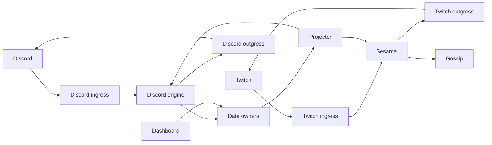

---
# Copyright (c) 2026 Adam Ousmer. All rights reserved.
# Proprietary. No license granted. See LICENSE.md.
title: Services
description: Service boundaries and source locations.
docType: reference
---

ItsBagelBot separates receiving events, deciding what to do, executing external effects, and owning durable data. Most service code is Go; Twitch ingress and the controls gateway are Elixir. NATS carries events and request/reply calls. The data services own their schemas; callers use RPC and projections instead of reading another owner's database.

The diagram shows the main paths, not every event or RPC. For message types and retry behavior, follow the linked source and shared contracts under `internal/domain/` and `pkg/bus/`.

## Service registry

| Area | Service | Source |
| --- | --- | --- |
| Twitch | [Ingress](/microservices/twitch-ingress/), [Sesame](/microservices/sesame/), [AutoMod](/microservices/automod/), [Outgress](/microservices/outgress/) | `app/twitch/` |
| Discord | [Ingress](/microservices/dingress/), [Engine](/microservices/discord-engine/), [Outgress](/microservices/discord-outgress/) | `app/discord/` |
| Data | [Users](/microservices/users/), [Commands](/microservices/commands/), [Modules](/microservices/modules/), [Loyalty](/microservices/loyalty/), [Discord data](/microservices/discord-data/), [Notifications](/microservices/notifications/), [Transactions](/microservices/transactions/) | `app/db/` |
| Shared runtime | [Projector](/microservices/projector/), [Gossip](/microservices/gossip/), [WARP image](/microservices/warp/) | `app/projector/`, `app/gossip/`, `app/warp/` |
| Desktop | [Controls gateway](/microservices/controls-gateway/), [Desktop app](/microservices/desktop/) | `app/controls/gateway/`, `app/desktop/` |
| Web | [Dashboard](/microservices/console/), [Admin](/microservices/admin/), [Marketing](/microservices/web/) | `web/` |

The repository also contains the desktop app (`app/desktop/`), release tooling (`app/release/`) and cluster operations (`app/clusterops/`). `app/plain/` is an unfinished scaffold and `app/yt-ingress/` is a placeholder. See `CONTEXT-MAP.md` for the full source map.
