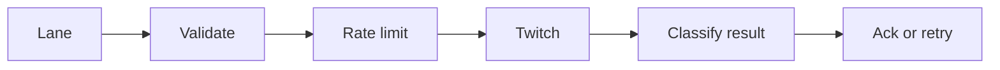

---
# Copyright (c) 2026 Adam Ousmer. All rights reserved.
# Proprietary. No license granted. See LICENSE.md.
title: Twitch outgress
description: "Executes Twitch API actions, chat delivery, EventSub enrollment and token use and refresh."
docType: reference
---

## Responsibilities

It consumes `twitch.outgress.{premium,standard,system}` and serves management and read RPCs. Workers classify failures for retry, coordinate fleet rate limits and reject trial-origin effects. Ingress owns Conduit sockets; Sesame decides what to do.

## Interfaces

Workers validate the typed message, select credentials and action, acquire coordinated capacity and execute the Twitch request. Premium and standard lanes carry ordinary output; the system lane carries longer-lived control work. Errors are classified for retry, and ordered batches checkpoint progress. An external request with an ambiguous result cannot be assumed to have happened exactly once.

## State and dependencies

Outgress uses stored credentials and shared rate-limit coordination; Users owns token custody and Ingress owns Conduit sessions.

## Failure behavior

Workers classify responses for retry. An ambiguous external effect cannot establish exactly-once delivery.

## Code map

Source: [app/twitch/outgress/](https://github.com/AdamOusmer/ItsBagelBot/tree/main/app/twitch/outgress). See `main.go`, `internal/worker/`, `internal/twitch/`, `rpc/`, and `internal/domain/outgress/`.

## Validation

Run `go test ./app/twitch/outgress/... ./pkg/ratelimit/...` from the repository root. The [validation page](/qa/outgress-hot-path-canary/) lists integration invariants.
