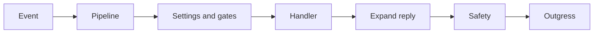

---
# Copyright (c) 2026 Adam Ousmer. All rights reserved.
# Proprietary. No license granted. See LICENSE.md.
title: Sesame
description: "Processes Twitch events, built-in modules and custom commands, incoming moderation, timers and replies."
docType: reference
---

## Responsibilities

Ingress delivers normalized events; Sesame resolves settings and commands through projections and RPC, applies gates and publishes typed actions to Outgress. Trial events exercise processing with output suppressed. Incoming AutoMod enforcement defaults off; completed outgoing replies also pass a safety check.

## Interfaces

Ingress supplies normalized lane envelopes; Sesame publishes typed `internal/domain/outgress` messages to the appropriate Twitch Outgress lane.

The pipeline resolves channel state, runs observers and moderation, dispatches eligible built-in or custom commands, expands variables and publishes described outputs. The registry in `modules/all.go` defines available handlers; each channel still controls its settings. Stream lifecycle followups use a bounded per-broadcaster sequencer; overflow runs inline and does not preserve FIFO order. Trial-origin outputs are suppressed.

## State and dependencies

Settings and commands come from projections and owner RPCs; Sesame does not own their SQL schemas.

## Failure behavior

Trial output is suppressed. Sequencer overflow runs inline and does not retain per-broadcaster FIFO order.

## Code map

Source: [app/twitch/sesame/](https://github.com/AdamOusmer/ItsBagelBot/tree/main/app/twitch/sesame). See `main.go`, `engine/pipeline.go`, `engine/dispatch.go`, `modules/all.go`, and `automod/`.

## Validation

Run `go test ./app/twitch/sesame/...` from the repository root. See `engine/pipeline.go`, `engine/moderate.go` and `internal/consumer/` for processing and retry boundaries.
