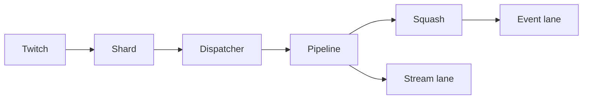

---
# Copyright (c) 2026 Adam Ousmer. All rights reserved.
# Proprietary. No license granted. See LICENSE.md.
title: Twitch ingress
description: "Receives Twitch EventSub notifications through a Conduit and supervised WebSocket shard sessions."
docType: reference
---

## Responsibilities

Ingress normalizes and routes events to lanes for Sesame and other consumers. It folds repeated plain chat while retaining sender information; commands bypass that squash. Stream lifecycle events also go to a dedicated stream lane. Sesame owns behavior and Outgress owns general Twitch effects and enrollment.

## Interfaces

The legacy event subjects are `twitch.ingress.event.{premium,standard,stream}`. Status lookup defaults to `bagel.rpc.broadcaster.status.get`; status invalidations use `bagel.cache.invalidate.status`.

Shard sessions hand notifications to a bounded dispatcher. The pipeline checks the event, chooses a lane and publishes the shared envelope. A publish admission is not the same as a JetStream acknowledgement. Stream online/offline events are published both to the stream lane and the ordinary lane, subject to channel eligibility. Status comes from RPC rather than another service’s database.

## State and dependencies

Ingress owns Conduit management and shard sessions. It obtains channel status through RPC.

## Failure behavior

Local admission to the publisher is distinct from a JetStream storage acknowledgement.

## Code map

Source: [app/twitch/ingress/](https://github.com/AdamOusmer/ItsBagelBot/tree/main/app/twitch/ingress). See `lib/ingress/application.ex`, `pipeline.ex`, `shard_session.ex`, `squash.ex`, and `nats/`; the shared envelope is `internal/domain/event/lane/lane.go`.

## Validation

From `app/twitch/ingress/`, run `mix test`. Inspect `lib/ingress/nats/publisher/` for broker verdicts and `test/` for focused cases.
