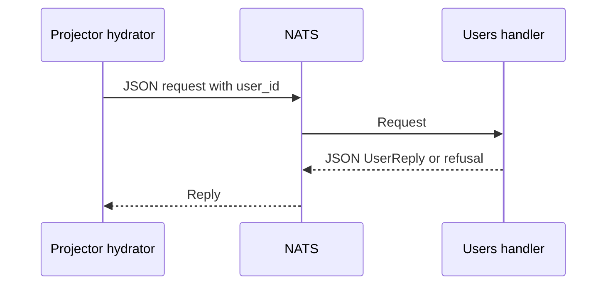

---
# Copyright (c) 2026 Adam Ousmer. All rights reserved.
# Proprietary. No license granted. See LICENSE.md.
title: RPC contracts
description: "Find and change NATS request-reply contracts safely."
docType: reference
---

Services use NATS request-reply for operations across ownership boundaries. Contract types live under `internal/domain/rpc/`; handlers and subject configuration live in the owning service under `app/`. This page shows how to trace a contract. It is not an exhaustive endpoint list.

## Example: user projection snapshot

The users service defaults to `rpc.internal.projection.users.get` (`app/db/users/main.go`). Its subject can be overridden with `NATS_INTERNAL_PROJECTION_USERS_SUBJECT`. `internal/domain/rpc/projection/projection.go` defines the JSON request and response. A request has a string user ID:

```json
{"user_id":"12345"}
```

`UserReply` includes `user_id`, `status`, `is_active`, `banned` and optional fields such as `locale`, as well as an embedded refusal. See the actual type for the full shape. The projector hydrator calls the users, modules and commands snapshot endpoints (`app/projector/hydration/hydrator.go`).



## Errors and deadlines

A successful transport does not mean the operation succeeded. Many replies embed `rpc.Refusal`, which carries an optional `error` and `code`. `internal/domain/rpc/code.go` defines `invalid`, `not_found`, `forbidden`, `conflict`, `unavailable` and `internal`; individual contracts can differ. A timeout or connection failure can prevent a reply altogether. Callers set deadlines, and handlers may impose their own; inspect both sides before changing them. Do not assume all IDs or errors use the same representation across every contract.

## Trace a change

1. Find the DTO and JSON tags in `internal/domain/rpc/<domain>/`.
2. Find the handler and its subject, environment override and queue wiring in the owning `app/` service.
3. Find callers and their timeout, error handling and authorization assumptions. Web callers also live under `web/`.
4. Check subject permissions in `deploy/messaging/accounts.yaml`, and update tests for both the wire shape and behaviour.

`pkg/bus/rpc.go` and `pkg/bus/rpcwiring.go` provide shared request and handler machinery. Event subjects are a different contract; see `internal/domain/event/` and `pkg/bus/streams.go` for their payloads and retention.

## Example: a missing account

The [users projection handler](https://github.com/AdamOusmer/ItsBagelBot/blob/main/app/db/users/rpc/projection.go) validates the user request through `ServeForUser` and loads the repository. An Ent not-found result becomes a `UserReply` containing `code: "not_found"` and an error message; other errors return through the shared RPC machinery. A client must distinguish that application reply from no reply due to a transport error or deadline. A retry after a timeout is especially significant for mutations: the server may have completed the operation even though the caller did not see the response.

For a contract change, compare the [DTO](https://github.com/AdamOusmer/ItsBagelBot/blob/main/internal/domain/rpc/projection/projection.go), [owner handler](https://github.com/AdamOusmer/ItsBagelBot/blob/main/app/db/users/rpc/projection.go), and [hydrator caller](https://github.com/AdamOusmer/ItsBagelBot/blob/main/app/projector/hydration/hydrator.go). Test malformed IDs, not-found, a successful reply, and timeout or unavailable dependencies as appropriate. Preserve existing JSON tags and subject permissions when making compatible additions.
