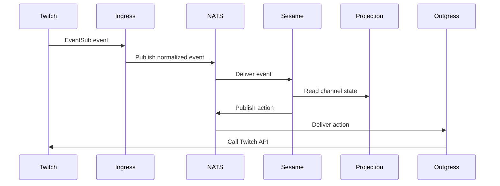

---
# Copyright (c) 2026 Adam Ousmer. All rights reserved.
# Proprietary. No license granted. See LICENSE.md.
title: System state
description: "Service locations and the path from an event to a reply."
docType: reference
---

## Service map

The repository separates platform I/O, bot decisions, data ownership and web interfaces. Services communicate through NATS; the stream definitions and their retention limits are in `pkg/bus/streams.go`.

| Area | Code | Responsibility |
| --- | --- | --- |
| Twitch ingress | `app/twitch/ingress/` | Receive and normalize Twitch events |
| Sesame | `app/twitch/sesame/` | Evaluate modules, commands and other bot behaviour |
| Twitch outgress | `app/twitch/outgress/` | Carry out Twitch actions |
| Data services | `app/db/` | Own application records and expose operations |
| Projector | `app/projector/`, `internal/projection/` | Maintain and serve derived state |
| Discord | `app/discord/` | Discord ingress, decisions and outgress |
| External APIs | `app/gossip/` | Provider integrations |
| Web | `web/dashboard/`, `web/admin/`, `web/marketing/`, `web/docs/` | Dashboard, administration, marketing and documentation |

## Common event flow

This shows a common chat path, not every event or fallback. Ingress uses premium and standard lanes; Sesame carries priority into outgress. The implementation and configuration define the actual timeouts, retry policies and retention for each lane. A durable consumer is not a guarantee of infinite retention or exactly-once processing.

For state ownership and hydration see [data and state](/data-and-state/). RPC types live under `internal/domain/rpc/`; [RPC contracts](/reference/rpc-contracts/) provides a starting map. `CONTEXT-MAP.md` describes service boundaries and placeholders. Deployment manifests live under `deploy/` and can change independently of these code boundaries.
